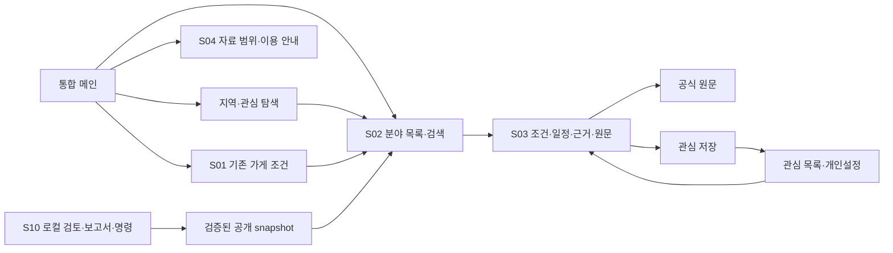

# 02. 화면·모바일 UX 명세

[확정 요구] **여기:it**의 대상은 안성시민 전체다. 통합 메인·분야 목록·지역/관심 탐색·상세·관심 저장·개인설정을 모바일 우선으로 설계한다. 교육·배움, 지원·혜택, 행사·문화, 공사·교통, 생활정보가 전체 범위이며 이번 버전 우선 분야·수집처는 [합의 필요]다. 기존 지점·영업시간 기능도 유지한다.

[현행 업무] AI/Figma 시안 → 팀 검토·피드백 → 화면 확정 → Flutter 구현 순서다. [웹 시제품](https://yeogi-it-neighborhood.kmnam001.chatgpt.site/)은 합성 자료·원문 예시로 된 동선 참고이며 기존 백엔드와 연결되지 않았다. [Figma 참고 파일](https://www.figma.com/design/lM2PFXTrzaJmLqbkVp4gUO)은 제공된 참고 대상이며 디자인 확인·확정의 근거가 아니다. 실제 Flutter 화면은 아직 없다. 배치·문구·URL·새 필드 연결은 [설계 제안]이며 화면별로 합의한다. 이전 11/3·11/4 시연은 [과거 기록]이다.

## 정보 구조와 공통 동작

메인 진입에 시험 지점·영업시간·로그인을 요구하지 않는다. 메인은 검색 진입, 5분야 진입, 선택 지역·관심으로 탐색하는 진입과 자료 범위 안내를 제공한다. 분야 목록과 지역 탐색은 같은 공지 상세로 연결하며 ‘나에게 맞음’을 신청 자격 확정으로 표시하지 않는다.

기존 문서의 `/`·`/notices`·`/notices/{event_id}`·`/about`는 화면 경로 예시다. 새 통합 메인·관심·설정 경로와 직접 진입·뒤로가기 동작은 화면 확정 때 합의한다. 공개 웹 경로와 API 경로를 혼용하지 않는다. `/review`는 로컬 관리 UI를 선택할 때의 예시이며 공개 배포에 포함하지 않는다. S01~S04/S10은 기존 추적 ID로 유지한다.

[기존 구현·계약] 기존 가게 조건 기능의 URL에는 공개 snapshot_id·event_id·mode만 허용한다. 지점·영업시간 등 가게 조건은 URL에 넣지 않으며 링크 공유에 포함되지 않는다고 안내한다. 관심 목록·개인 설정값도 URL에 넣지 않는다. 시민용 공개 검색어·필터의 URL 반영·공유 정책은 개인 설정과 구별해 화면/API 합의에서 정한다.

- 관심 저장·개인설정은 초기 프런트의 해당 브라우저에 보관한다. 저장 방식·키·이전 자료 처리·초기화는 구현 전 합의한다. ‘이 브라우저에 저장됨 / 다른 기기와 동기화되지 않음’을 안내한다. 브라우저 데이터 삭제 시 지워질 수 있으며 저장 실패는 성공으로 표시하지 않는다. 기존 가게 조회 조건의 탭별 sessionStorage 동작은 별도로 보존한다. 서버 영구 저장·계정 동기화·새 인증·알림 발송은 자동 필수 항목이 아니다.
- 뒤로 가기 시 검색어·필터·목록 위치를 복원한다. 요청 기준 시각·자료 버전을 표시하고 새 snapshot 적용 시 변화 안내 후 재조회한다. 상세가 이전 버전이면 갱신을 알린다.
- 날짜가 바뀌면 재조회 안내를 표시한다. 신청·진행 상태는 서버가 반환한 기준과 출처 상태를 사용하며 클라이언트 시계로 자격·모집 여부를 확정하지 않는다.
- 터치 영역 44×44 CSS px 이상, 본문 기본 16px·행간 1.5. 상태는 색+아이콘+글자. 제목·주소·조건은 줄바꿈하며 핵심 문구 말줄임 금지.
- 입력마다 보이는 라벨·오류 연결·키보드 초점을 제공한다. 로딩/건수는 상태 알림, 오류 요약은 초점 이동. 아이콘만 있는 조작 금지. 연령·디지털 이용 수준이 다른 시민이 필터 해제·뒤로가기·원문 이동을 이해하는지 검토한다.
- 빈 결과는 ‘수집된 자료 중 이 조건에 맞는 정보가 없습니다’로 표현한다. 수집 범위 밖 정보까지 없다고 단정하지 않으며 실패를 0건으로 표시하지 않는다.

## S01 — 가게 조건 선택

[기존 구현·계약] 소상공인 시간·거리 후보 기능의 별도 진입이다. 통합 메인의 선행 조건이 아니다. 회원가입 없이 기존 시험 지점·요일별 영업시간을 선택한다. R01/R02/R12/R14/R16, D01/D02/D07, I01/I02, T01/T02/T16/T18에 연결한다.

초기 지점 미선택, 영업시간 unknown, 기존 세 유형 전체, current 모드다. `09:00~18:00`은 입력 예시이며 자동 저장하지 않는다. 오늘 포함 14일·직선 500m는 기존 기능의 고정 기준으로 표시한다. 시민 탐색 전체의 범위로 사용하지 않는다.

지점 1개, 요일별 unknown/open/closed, open의 1~3개 구간과 HH:mm·다음 날 종료를 기존 계약대로 입력한다. 시작=종료는 오류이며 24시간은 별도 선택한다. 휴무는 그날 시작하는 영업이 없다는 뜻이고 전날부터 이어진 구간은 유지한다. 삭제는 되돌릴 수 있게 알리고 영업 미입력은 허용하되 중첩을 확인할 수 없다고 표시한다. 키보드가 열려도 제출 버튼에 스크롤로 도달한다.

I01 로딩·미준비·실패와 입력 오류를 구분한다. 검토된 지점이 없으면 준비 중 안내와 재시도를 제공하고 가짜 지점을 생성하지 않는다. 선택 지점은 참여 점포가 아니다. 기존 I02 호출 후 S02의 소상공인 결과로 이동하며 중복 요청을 차단한다.

## S02 — 관련 공지 목록

[확정 요구] 목록·검색과 지역·분야·모집 상태·비용·기간·정렬을 제공한다. R17/R18과 기존 R03~R09/R12/R14/R16의 공통 표시 원칙을 적용한다. 기존 I02는 소상공인 조건 조회이며 새 시민 목록·필터 API가 구현됐다는 뜻이 아니다.

| 조작·표시 | 화면에서 구별할 의미 | 합의·검증할 점 |
|---|---|---|
| 검색어 | 제목·내용 등 합의한 검색 대상 | 검색 범위·공백·일치 방식·초기화·오류 |
| 지역 | 공지의 적용 지역·행사 장소·거주 자격 지역 | 행정구역 단계와 전체 선택; 거주 자격을 가까운 위치로 대신하지 않음 |
| 분야 | 교육·배움 / 지원·혜택 / 행사·문화 / 공사·교통 / 생활정보 | 복수 분야·기존 세 유형 대응·미분류 처리; 새 enum 합의 전 |
| 모집 상태 | 신청 전·접수 가능·신청 마감 등 원문에 근거한 상태 | 일정만으로 판단할 수 없는 선착순·상시·정원마감·미상을 별도 처리 |
| 비용 | 원문에 명시된 무료·유료·조건별 금액·미기재 | 미기재를 무료로 필터링하지 않음; 재료비 등 추가 비용 보존 |
| 기간 | 신청 시작/마감과 실제 진행일정 | 어떤 기간을 검색 중인지 라벨; 날짜 미상을 임의 현재로 채우지 않음 |
| 정렬 | 관심 관련·신청 마감·진행일정 등의 참고 시안 | 실제 지원 범위·동률·미상·안정 순서를 화면/API 합의로 확정 |

시제품의 ‘모집중·무료·이번주 진행·7일 내 신청 마감’은 서로 다른 조건의 빠른 탐색 예시다. 같은 기간 필드로 묶지 않는다. 지역 단계·관심 정렬도 시안이며 자동 위치·거리 계산 구현의 증거가 아니다. 적용 필터·결과 건수·해제/전체 초기화를 표시한다. 복수 선택의 결합 방식과 전체 선택 의미는 화면 확정 때 정한다.

카드는 공지/사건 ID를 기준으로 중복 없이 보여준다. 분야·제목·적용 지역/장소·신청기간·진행일정·모집 상태·비용·핵심 대상/조건·출처·마지막 확인 시각·주의/변경 상태를 구분해 표시한다. 해당 없는 항목과 미확인을 구별한다. 긴 대상·예외·불확실성은 접어 숨기지 않는다. 제목의 상세 링크와 원문 버튼은 중첩 링크를 만들지 않는다. 카드의 개인정보·자격 확정 문구를 만들어 넣지 않는다.

[기존 구현·계약] S01을 사용한 결과는 candidate/needs_check/cancelled와 construction/event/traffic를 그대로 구별한다. 후보 0건이면 확인 필요 건수와 이동을 제공하며 합산을 후보 수로 표시하지 않는다. 기존 유형은 OR, 빈 선택은 전체다. 기본 정렬은 조회창 내 첫 시작→거리→event_id, 거리순은 미상 마지막, 취소는 취소 확인일 최신순을 유지한다. 날짜만 있는 항목의 00:00은 정렬 키이며 실제 시각으로 표시하지 않는다. C09 동시간 묶음은 실제 공통 구간과 링크만 보여주고 카드 수에 더하지 않는다. 이 분류를 신규 모집 상태·분야로 재사용하지 않는다.

로딩 중 이전 결과는 이전 조건의 결과임을 명시한다. 새 조건 요청 실패 시 조건·이전 결과를 보존하고 재시도를 제공한다. 확인 필요는 원문 미확인·날짜/위치 미상 등 이유와 원문을 먼저 보여준다. 취소·신청 마감·진행 종료는 별도 의미다. 모바일은 한 열·세로 스크롤·필터 줄바꿈을 기본으로 한다. 자료 증가 시 목록 크기·페이지 방식은 API와 함께 합의하고 기존 40문서 가정을 시민 전체의 상한으로 쓰지 않는다.

## S03 — 조건·근거·공식 원문

목적: 시민이 신청·참여·생활 판단에 필요한 사실과 확인할 내용을 이해하도록 한다. R19/R20 및 R05~R12/R14에 연결한다. 기존 D03~D07·I03의 근거/출처는 재사용하고 새 상세 필드는 [03 데이터 설계](03_데이터와AI.md)의 합의 대상과 대조한다.

| 상세 구획 | 필수 표시·동작 |
|---|---|
| 기본 정보 | 제목·분야·주관/출처 기관·지역/장소·게시일; 원문 미기재 표시 |
| 두 일정 | 신청 시작/마감, 실제 진행일정·반복/시간·변경 여부를 각각 표시 |
| 대상·신청조건 | 대상, 연령/거주/기타 자격, 예외·제외 조건, 근거; 연령·관심 일치만으로 자격 확정 금지 |
| 신청·참여 | 방법·연결 원문·준비사항; 불명확하면 확인 필요, 없는 절차 생성 금지 |
| 비용 | 무료/금액/조건별 부담·추가 비용·미기재; null을 0원으로 바꾸지 않음 |
| 출처·확인 | 문서별 원문 링크·게시일·성공 확인 시각·최근 확인 결과와 자료 버전 |
| 변경 | 확보한 이전/새 값·근거·확인 시점만 표시; 미확보 시 ‘변경 여부 미확인’ |
| 관심 저장 | 현재 브라우저 저장/해제, 저장 실패 안내, 보관 범위 표시 |

‘원문에 적힌 사실 / 계산 또는 개인설정과의 비교 / 이용자가 확인할 사항’을 구분한다. 근거 인용 전체는 접을 수 있지만 대상·예외·불확실성·현행 취소는 항상 보인다. 변경 이력은 출처 검토가 확보된 범위만 보여주며 이력 부재를 ‘변경 없음’으로 표시하지 않는다. 신청이 끝나도 진행 전/진행 중일 수 있고, 진행 종료만으로 신청 이력을 덮지 않는다.

[기존 구현·계약] 시간·거리 계산 영역은 같은 snapshot의 I02 결과가 있을 때만 결합한다. I03은 조건 없는 사실 응답이다. 직접 진입 시 지점 선택 안내를 제공하며 미계산·확인 필요를 0분/0m로 채우지 않는다. 직선거리·시간 중첩은 실제 통행·영업 영향이나 신규 지원 자격을 보증하지 않는다.

원문은 새 탭임을 안내하고 접근 가능한 일반 링크를 제공한다. 돌아오면 상세/목록 조건을 유지한다. 원문 버튼의 존재와 현재 접속 가능 여부는 구별하며 브라우저가 타 사이트의 상태를 자동 확인한다고 가정하지 않는다. 404·비공개·폐기 snapshot·조회 실패를 구별하고 목록/현재 공개본 이동을 제공한다. 원문 연결 실패도 과거 확인 사실·링크를 지우지 않고 최근 결과와 확인 필요를 표시한다.

## S04 — 자료 범위·이용 안내·재현 선택

모든 화면에서 자료 범위·한계·브라우저 저장 안내에 접근한다. 실제 수집처·분야·지역·기간, 고유 문서/사건 수, snapshot 작성 시각, 원문 성공 확인 시각 범위, 전수 감시 아님을 표시한다. 자료가 없으면 미등록으로 표시한다. 실제 운영 연락처·기관 로고·보증 문구는 확인 없이 넣지 않는다.

[기존 구현·계약] 과거 재현은 등록 case_id와 기준일을 선택하고 S01~S03에서 ‘실제 현재 안내 아님’을 유지한다. 현재로 돌아갈 때 기준일·과거 snapshot·결과를 초기화한다. 과거본이 없으면 빈 상태와 이유를 표시하며 자유 날짜 입력으로 미래 정정을 섞지 않는다. 시민 신규 분야의 과거 재현은 자료·계약 합의 없이 지원된다고 표시하지 않는다.

## 관심 저장·개인설정

[확정 요구] 초기에는 로그인 없이 브라우저에서 관심 저장·해제와 개인설정을 제공한다. 목록/상세의 저장 상태를 일관되게 표시하고 관심 목록에서 상세·원문으로 이어진다. 데이터 없는 관심 화면, 삭제된/비공개 공지, 오래된 저장본, 저장 실패를 구분한다. 관심 목록을 실시간 최신 공지·개인 자격 승인으로 표현하지 않는다.

개인설정은 탐색을 돕기 위한 선택이다. 구체 항목·연령 입력의 필요성/수준·개인화 기준·보관 기간·초기화는 남규민과 합의한다. 불필요한 생년월일·신분 증빙·연락처·신청서 수집을 추가하지 않는다. 전체 삭제 전 대상과 효과를 알리고 실수로 저장 자료를 잃지 않도록 한다. 계정·기기 동기화·푸시·자동 알림은 별도 요청 없이는 이번 필수가 아니다.

## S10 — 팀 공지 검토·공개 (로컬 전용)

[기존 구현·계약] 수집·AI 원출력·사람 수정·관계·승인·공개 검증의 검토 업무다. 별도 관리 UI를 새 필수 완료 게이트로 만들지 않는다. 동등한 **비공개 로컬 HTML 보고서·명령 방식**도 허용하며 [검토 보고서](../../backend/docs/review-report.md)와 [관리 API](../../backend/docs/local-management-api.md)를 재사용한다. 이 절은 관리 UI 구현 완료를 뜻하지 않는다.

원문·모든 AI 시도/실패·사람 검토값·필드 근거·변경 이유·승인/공개 이력을 구분해 확인한다. 초기 draft/hidden, unknown 명시, 자동 사건 병합·자동 승인은 금지한다. 검토자 식별자는 운영 기록이며 실제 신원 인증으로 표현하지 않는다. 원본의 개인정보와 평가 기록은 공개하지 않는다.

승인과 공개는 별도이며 preview에서 새 카드·변경·취소·오류를 확인한다. revision 충돌·원문/OCR·AI·저장 실패를 구별하고 이전본을 유지한다. UI를 구현하는 경우에도 동일 검증·동의 없는 전송 방지·파일 한도와 입력 이탈 경고를 적용한다. 공개 웹에는 관리 경로를 두지 않으며 Bearer·loopback·Host·Origin 경계를 유지한다. 검토 HTML은 private 출력으로 다루고 원문 HTML/AI 문자열을 실행하지 않는다.

## 반응형 기준과 품질 인수

| 폭 / 상황 | 배치와 동작 |
|---|---|
| 320~767 CSS px | 한 열, 좌우 16px 기본 여백(320px에서는 12px), 필터 줄바꿈, 버튼 최소 44px |
| 768~1023 | 목록 중심 최대 760px, 필터 상단, 상세 별도 화면; 세로/가로 동일 정보 |
| 1024 이상 | 최대 1280px; 목록/상세 2열 가능, 기존 가게 조건은 해당 기능에서만 표시 |
| 모바일 가로·높이 500px 미만 | 세로 문서 스크롤, 고정 하단 버튼이 내용을 가리지 않음 |
| 200% 글자 확대 | 한 열 재흐름, 핵심 문구 가림·수평 스크롤 없음 |

시험 크기 320×568, 390×844, 844×390, 768×1024, 1024×768, 1366×768. iOS Safari·Android Chrome 실기기 각 1대와 PC Chromium 계열의 버전을 기록한다. 기기 미확보는 에뮬레이션 확인으로 구분한다. 터치·키보드로 검색·필터 해제·관심 저장·원문 도달이 가능하고 상태를 글자만으로 구별해야 한다. 연령·디지털 수준별 실제 인수 결과와 미검증을 기록한다.

## v1.1 Flutter Web 구현 대응

[확정 요구] Flutter Web·Dart를 유지한다. 확정 시안을 Dart 위젯·LayoutBuilder/MediaQuery·Semantics로 구현하며 기존 HTML을 복사해 앱이 완성됐다고 표현하지 않는다. CSS px 기준은 logical pixel과 브라우저 확대·뷰포트에서 함께 확인한다.

[기존 구현·계약] 날짜·거리·기존 후보 분류는 서버 결과를 표시한다. Dart에 Python 계산을 복제하지 않는다. 검증된 quote를 사용하며 Python code point offset을 Dart substring으로 그대로 쓰지 않는다. [합의 필요] 새 목록/검색/필터·신청/진행일정·비용·관심 관련 데이터와 오류는 화면별 계약으로 확정한 뒤 연동한다. 기존 세 API 응답에 새 필드가 있다고 가정하지 않는다.
