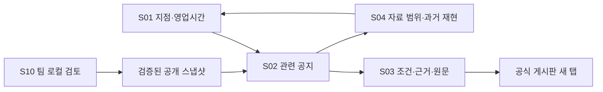

# 02. 화면·모바일 UX 명세

> 이 파일은 전체 MVP 명세입니다. **11/3(화) 오후6시 인계·11/4(수) 연구실 PC 시연**의 우선 작업은 [화면 시연 작업 기준](../wednesday-screen-brief.md)을 따릅니다. 전체 기능·정량 목표는 유지합니다.

> **v1.1 기술 결정(2026-11-02): Flutter Web·Dart / Spring Boot·Java / MySQL / Python AI·계산.** 전체 기능·평가 목표를 유지합니다. 상세 연결은 [08 기술 구성](08_기술구성과연결.md), DB는 [09 DB 설계](09_DB설계와트랜잭션.md), 인원별 작업은 [10 WBS](10_인원별WBS.md)를 따릅니다.

모바일 우선은 [확정 요구], 배치·문구·기본값은 [설계 제안]. 와이어프레임의 ‘예시’ 데이터는 모두 가상이며 실제 안성 공지나 확보한 지점이 아니다.

## 정보 구조와 공통 동작



URL: `/` S01, `/notices` S02, `/notices/{event_id}` S03, `/about` S04. `/review` S10은 별도 로컬 관리 실행에서만 존재하며 공개 배포에는 포함하지 않는다. 사용자 조건은 탭 단위 sessionStorage에만 보관하고 서버에 영구 기록하지 않는다. URL에는 공개 snapshot_id·event_id·mode만 허용한다. 가게 조건은 링크 공유되지 않는다고 안내한다.

- 한 요청의 기준일·자료 버전은 결과 헤더에 고정. 한국 날짜가 바뀌면 ‘날짜가 바뀌었습니다. 오늘 기준으로 다시 보기’ 버튼을 표시한다. 이전 화면을 조용히 재계산하지 않는다.
- 브라우저 뒤로 가기 시 조건·필터·목록 위치 복원. 신규 snapshot 적용 시 변화 안내 후 재조회. 상세가 이전 버전이면 ‘자료 갱신됨’ 표시.
- 터치 영역 44×44 CSS px 이상. 본문 기본 16px·행간 1.5, 상태는 색+아이콘+글자. 제목/주소는 줄바꿈, 의미 있는 문구 말줄임 금지.
- 모든 입력에 보이는 라벨, 오류와 입력 연결, 키보드 초점 표시. 로딩/결과 건수는 방해하지 않는 상태 알림, 오류 요약은 초점 이동. 아이콘 단독 조작 금지.
- 초기 결과는 자동 추천 확정이라는 표현 대신 **‘시간·거리 조건이 맞는 후보’**. 빈 결과에서도 ‘주변 변화 없음’이라고 쓰지 않는다.

## S01 — 가게 조건 선택

목적: 회원가입 없이 시험 지점과 영업시간을 정한다. 진입: 첫 접속 또는 S02 ‘조건 변경’. 요구: R01/R02/R12/R14/R16. 데이터 D01/D02/D07, I01/I02. 인수 T01/T02/T16/T18.

```text
┌─────────────────────────────┐
│ 가게앞 변화알림 안성          │
│ 안성맞춘 시민 실증 시제품     │
│ [현재 안내] [과거 사례 재현]  │
│ 시험 지점                    │
│ [지점을 선택하세요       ▾]  │
│ 시험 지점이며 참여 점포 아님  │
│ 영업시간                     │
│ ○ 시간 입력  ● 아직 미입력   │
│ [모든 요일] [요일별 설정]    │
│ 09:00 ~ 18:00  □ 다음 날 종료│
│ [구간 추가] / [휴무]         │
│ 오늘 포함 14일 · 직선 500m   │
│ [       관련 공지 보기      ]│
└─────────────────────────────┘
```

기본값: 지점 미선택, 영업시간 미입력(unknown), 세 유형 전체, 현재 모드. 09:00~18:00은 입력 방법의 예시 플레이스홀더이며 실제 입력으로 저장하지 않는다. 기본 14일·500m는 표시만 하고 MVP에서는 임의 조절 기능을 요구하지 않는다.

입력: 지점 1개 필수; 요일별 unknown/open/closed, open이면 1~3개 구간. 모든 요일 편집은 7요일로 복제하되 각 요일 추가 수정 가능. 시작/종료 HH:mm, 다음 날 종료 체크. 같은 시작·종료는 오류이며 24시간은 별도 ‘24시간 영업’ 선택. 휴무 선택 시 기존 구간을 지우기 전에 되돌릴 수 있게 알림. 자정 통과 구간이 다음 날 휴무에 걸쳐도 전날 개시 영업의 연속으로 처리한다고 입력 옆에 표시.

모바일은 기본 select/time 입력과 명시적인 다음날 체크를 사용한다. 플랫폼의 시간 선택 UI 차이를 고려해 HH:mm 검증 메시지를 제공한다. 키보드가 떠도 제출 버튼은 스크롤로 도달하며 화면 위에 겹쳐 고정하지 않는다. 구간 삭제 후 초점은 해당 요일 추가 버튼으로 복귀한다.

오류: 지점 없음 ‘시험 지점을 선택해 주세요’; 잘못된 시간/0길이 ‘시작·종료와 다음날 여부를 확인해 주세요’; 겹친 구간은 저장 시 합집합 처리 후 안내. 3개 초과는 추가 버튼 비활성 및 이유 표시. 영업 미입력은 허용하되 ‘영업시간 중첩은 확인할 수 없습니다’ 표시.

상태: I01 로딩 시 선택 비활성; 설정 없음/5지점 미준비는 ‘시험 지점을 준비 중입니다’(가짜 지점 자동 생성 금지); 실패는 재시도, 이전 입력 유지. 조건 저장 후 I02 결과 화면으로 이동하며 재클릭 중복 요청 차단.

## S02 — 관련 공지 목록

목적: 후보·확인 필요·취소를 구분하며 관련 공지를 탐색한다. 진입 S01 적용/상세 뒤로. 요구 R03~R09/R12/R14/R16. 데이터 D06/D07, I02, T03~T13/T18/T20.

```text
┌─────────────────────────────┐
│ 예시 지점 A · [조건 변경]    │
│ 11.02~11.15 · 직선 500m      │
│ [공사✓] [행사✓] [교통✓]     │
│ 후보 2 | 확인 필요 1 | 취소 1│
│ 정렬 [시작일순 ▾]            │
│ 같은 시간의 변화: 11.03 14~15│
│ [예시 행사] [예시 공사]      │
├─────────────────────────────┤
│ 공사 · 시간·거리 조건 일치   │
│ 가상 예시: 도로 보수         │
│ 11.03 14:00~16:00            │
│ 예시 도로 구간 · 기준점 320m │
│ 대상: 원문에 기재된 차량     │
│ 예외: 반대 방향은 변경 없음  │
│ ! 구간·방향 원문 확인 필요   │
│ 게시 11.01 / 확인 11.02 09:00│
│ [조건·근거 보기] [공식 원문↗]│
└─────────────────────────────┘
```

기본은 후보 섹션. 바로 위에 확인 필요·취소 건수 버튼을 항상 노출한다. 후보가 0이고 확인 필요가 있으면 빈 상태에 ‘확인 필요 n건 보기’를 제공한다. 두 섹션을 합친 숫자를 후보 수로 표시하지 않는다. 유형 필터는 OR이며 모두 해제하면 세 유형 전체로 돌아가고 안내한다. 상태 전환은 필터를 유지한다.

카드는 사건 단위 1장. 유형 복수면 모든 유형 배지 표시. 날짜/시간, 장소, 계산 가능한 거리와 기준, 적용 대상, 예외 전문, 주의 이유, 게시일(미기재 가능), 최종 확인 시각, 변경 상태를 표시한다. 긴 대상/예외는 줄바꿈하며 모바일에서 접어 숨기지 않는다. 상세에는 반복 구간 전체와 근거를 제공한다. 카드 제목은 상세 링크지만 원문 버튼과 중첩 링크를 만들지 않는다.

정렬: 기본 ‘해당 조회 기간 내 첫 시작 시각’ 오름차순 → 거리 → event_id. 이미 진행 중은 조회창 시작 시각 사용. 날짜만 있으면 그날 00:00을 **정렬 키로만** 사용하고 실제 시간으로 표시하지 않는다. 날짜 미상은 마지막. 거리순은 계산 가능한 거리 오름차순, 미상 마지막, 동률은 시작순. 취소는 cancel 확인일 최신순. 순서가 필터 변경으로 바뀌면 목록 상단과 건수로 안내한다.

동시간 묶음은 C09에서 확인된 공통 구간만 표시하고 각 상세로 이동한다. 섹션 위 요약은 사건 수에 추가하지 않는다. ‘두 사건 때문에 통행 불가’ 같은 추론은 하지 않는다.

로딩: 이전 결과가 있으면 회색 비활성 + ‘조건을 다시 계산 중’; 새 응답 이전의 결과를 새 조건 결과로 표시 금지. 오류 시 이전 조건과 이전 결과를 명시하고 재시도. 0건: ‘수집된 자료 중 이 조건에 맞는 후보가 없습니다. 전체 공지를 확인한 결과는 아닙니다.’ 조회 실패는 별도 오류 패널. 확인 필요 섹션은 이유(시간 미상/위치 미확정/최신 확인 지연 등)와 원문 버튼을 먼저 보여준다. 취소 섹션은 ‘취소 확인됨’ 배지와 취소 문서 링크; 유효 후보와 혼합 금지.

모바일은 한 열·전체 페이지 세로 스크롤, 필터는 두 줄까지 줄바꿈. 가로 슬라이더 사용 안 함. 40문서 수준에서는 페이지 나눔/무한 스크롤 없이 사건 목록 전부 렌더링하되 상세 근거는 별도 화면. 스크롤 중 원문 버튼은 카드 내 유지한다.

## S03 — 조건·근거·공식 원문

목적: 사실과 계산을 구분해 사용자가 확인하도록 한다. 진입 카드/동시간 묶음/공개 상세 링크. 요구 R05~R12/R14. D03~D07, I03 및 조건이 있을 때 I02, T09~T16/T18.

```text
┌─────────────────────────────┐
│ [← 목록]  공사 · 정정됨      │
│ 가상 예시: 도로 보수         │
│ ! 적용 방향·예외 확인        │
│ ① 원문에 적힌 사실          │
│ 기간 / 구간 / 대상 / 예외    │
│ [근거 문장과 출처 펼치기]    │
│ ② 선택 조건으로 계산한 결과 │
│ 직선 320m · 시간 중첩 60분   │
│ 실제 통행·영업 영향은 미판정 │
│ ③ 추가로 확인할 사항        │
│ 해당 방향·정류장 여부 확인   │
│ 변경: 종료 17시 → 16시       │
│ 확인 11.02 09:00 / 출처 기관 │
│ [       공식 원문 열기 ↗    ]│
└─────────────────────────────┘
```

사실 영역: 모든 occurrence·location·대상·예외, 문서별 근거 인용. 근거 원문만 접기 허용; 대상·예외·불확실성은 항상 보인다. 게시일 미기재는 ‘원문 게시일 미기재’. 확인 시각과 원문 상태 확인 시각을 혼동하지 않도록 라벨을 붙인다.

계산 영역: 시간창/영업 구간과 교집합·거리 계산 기준·버전. 사용자 조건 없이 직접 진입하면 ‘지점을 선택하면 시간·거리를 비교할 수 있습니다’로 표시한다. 기존 다른 사용자의 계산 값을 재사용하지 않는다. 확인 필요 상태에서는 알 수 없는 값을 0분/0m로 표시하지 않는다.

변경 이력: 최근 적용 변경 항목과 이전/새 값, 근거 문서 링크. 같은 문서의 수정은 원문 버전 hash와 함께 추적. 전체 과거 이력은 접어도 현행 취소·정정 사실은 상단 고정. 원문은 새 탭으로 열고 새 탭임을 알린다. 모바일에서 돌아오면 상세/목록 조건 유지. 브라우저가 새 창을 막으면 일반 링크 열기를 제공한다.

존재하지 않거나 비공개 사건은 404 안내와 목록 이동. 이전 버전 ID는 접근 가능한 최신 공개본 링크 제공. 원문 연결 실패는 발견된 최근 확인 결과와 날짜를 표시하고 최신 확인 필요 상태로 이동한다. 브라우저에서 타 사이트 응답을 확인할 수 있다고 가정하지 않는다. 원문 버튼이 있는 것과 현재 접속 가능 여부를 구별한다.

## S04 — 자료 범위·이용 안내·재현 선택

목적: 수집 범위/한계와 현재/과거 구분을 이해한다. 모든 화면 하단에서 진입. R06/R12/R16, D07, I01. T16/T20.

표시: 팀·시범 구역, 실제 자료원 목록, 문서 수/사건 수, 수집 기간, snapshot 작성 시각, 마지막 원문 재확인 시각 범위, 전수 감시 아님, 문의 방식(실제 운영 연락처는 확인 후 등록). 수집 범위 없는 상태는 ‘자료 미등록’. 임의 운영기관 로고·보증 문구 금지.

재현은 등록된 case_id와 기준일을 선택한다. ‘과거 사례 재현 — 실제 현재 안내 아님’ 배너를 S01~S03에 계속 유지한다. 현재로 돌아갈 때 기준일·과거 snapshot·결과를 함께 초기화하고 지점/영업시간은 유지 가능. 과거 snapshot이 없으면 재현 목록 빈 상태와 이유를 표시한다. 날짜 자유 입력으로 미래 정정이 섞이는 임의 재현을 만들지 않는다.

## S10 — 팀 공지 검토·공개 (로컬 전용)

목적: 수동 수집/AI 파일 가져오기/사람 검토/변경 관계 확인/공개 검증. R03/R07/R11/R13/R15, D03~D09, I10~I12. T11/T14/T17/T21/T22.

```text
문서 목록 → [원문·출처] [AI 원출력] [사람 검토값] → 검증 결과
                                              ↓
                   [보류 저장] [검토 승인] → [공개 묶음 생성]
```

초기값: draft·비공개. 입력은 공식 URL·기관·제목·게시일(미상 허용)·본문 또는 파일·수집/확인 시각. AI 요청파일 내보내기/결과파일 가져오기 제공, 승인되지 않은 도구에 자동 전송하지 않는다. AI 원출력 읽기 전용, 사람 수정값은 필드별 근거와 변경 이유 필수. ‘unknown’은 명시적으로 선택하며 빈 문자열과 구분한다.

동일 URL 수정본/새 문서/같은 사건 관계는 후보만 제시하고 사람이 선택. 자동 병합 금지. 판정 불가 시 보류. 검토자는 선택된 팀원 식별자만 로컬 기록하고 복잡한 가입/권한 체계는 만들지 않는다. 로컬 단일 관리자를 운영 가정으로 하고 실제 공동 검토는 내보낸 검토표로 수행한다.

승인 버튼은 스키마/근거/출처/필수 검토 통과 전 비활성. 승인과 공개는 별개 버튼이며, 공개 전 새 카드·변경 수·취소 수·오류 목록을 미리 본다. 성공 시 snapshot_id·파일 경로·checksum 표시. 버전 충돌은 409와 최신본 재읽기. 작업 실패 시 마지막 저장본 유지; 입력 이탈 경고. 스캔/OCR 실패·AI 실패·원문 실패를 각각 표시한다.

PC는 원문/AI/수정값 3열 비교, 모바일은 같은 항목을 순차 탭으로 제공한다. 관리 업무는 PC 권장이나 핵심 검토값 누락은 없다. 파일 선택은 확장자·크기·스키마 검증 후 처리하고 원문 HTML을 그대로 실행하지 않는다.

## 반응형 기준과 품질 인수

| 폭 / 상황 | 배치와 동작 |
|---|---|
| 320~767 CSS px | 한 열, 좌우 16px 기본 여백(320px에서는 12px), 필터 줄바꿈, 버튼 최소 44px |
| 768~1023 | 목록 중심 최대 760px, 필터 상단, 상세 별도 화면. 태블릿 세로/가로 동일 정보 |
| 1024 이상 | 최대 1280px: 조건 240px + 목록 나머지, 상세 선택 시 목록/상세 2열 가능; URL 동일 |
| 모바일 가로·높이 500px 미만 | 가로폭과 무관하게 세로 문서 스크롤, 고정 하단 버튼 사용 안 함 |
| 200% 글자 확대 | 레이아웃 재흐름, 다열 불가 시 한 열; 핵심 문구 가림·수평 스크롤 없음 |

시험 크기 320×568, 390×844, 844×390, 768×1024, 1024×768, 1366×768. iOS Safari·Android Chrome 실기기 각 1대, PC Chromium 계열에서 버전을 기록해 검증한다. 실기기 미확보 시 에뮬레이션만으로 실기기 통과라고 보고하지 않는다. 터치·키보드로 동일 원문 도달 가능, 상태 글자만으로 후보/확인 필요/취소 구별, 모든 필수 조건에 스크롤로 도달하면 인수한다.


## v1.1 Flutter Web 구현 대응

본 문서의 S01~S04/S10·입력·상태·와이어프레임·viewport 인수 기준은 Flutter Web에서도 유지한다. HTML/CSS 컴포넌트 복사를 전제로 하지 않고 Dart 위젯·LayoutBuilder/MediaQuery·Semantics로 구현한다. px 기준의 터치/레이아웃은 Flutter logical pixel과 실제 브라우저 확대/뷰포트에서 함께 확인한다.

브라우저 뒤로가기·상세 직접 진입·조건/필터 복원·원문 새 탭·KST 표시는 08 기술 구성의 웹 기준을 적용한다. 날짜/거리/분류는 서버 결과를 표시하고 Dart에서 별도 계산하지 않는다. 근거는 검증된 quote를 표시하며 Python code point offset을 Dart substring 위치로 그대로 사용하지 않는다. 공개 API 필드와 미상/null·출처/예외 정보는 기존 계약을 보존한다.
