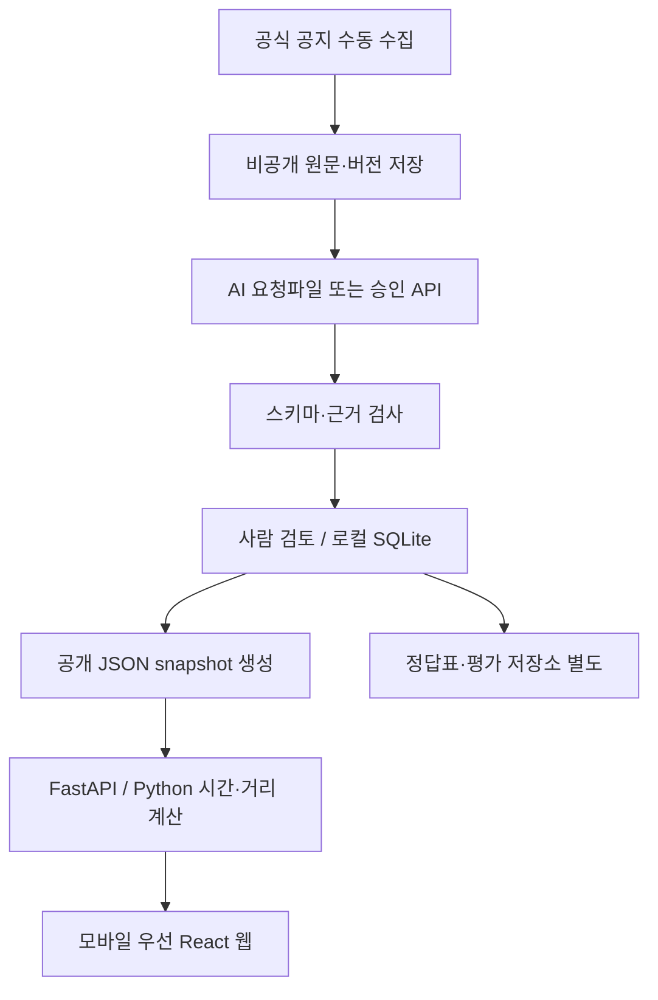

# 04. 계산 규칙·기술·운영 설계

> 수요일 공유 버전의 실행 분담은 [저장소 README](../../README.md)와 [수요일 실행안](../wednesday-plan.md)을 우선합니다. 이상헌=프런트, 강명묵=백엔드, 김윤기=AI, 남규민=통합·배포 조율입니다. 아래 전체 명세의 장기 역할표와 구분합니다.

본 파일의 세부 경계값·기술 선택은 [설계 제안]이다. 14일·500m·Python 계산·세 유형·불확실성 보존은 S1/S2/U1의 [확정 요구]. 모든 날짜·사건 예시는 가상이다.

## 계산 결정표

한 사건을 candidate(후보), needs_check(확인 필요), cancelled(취소), excluded(선별 제외) 중 하나로 분류한다. 서로 다른 occurrence의 날짜와 장소를 섞지 않는다. **알려진 값만으로 조건 불일치가 확정되면 제외; 필요한 조건이 미상이고 불일치가 확정되지 않으면 확인 필요**가 원칙이다.

| 단계 | 규칙 | 결과 |
|---|---|---|
| 0 | 비공개/미승인/구역 밖/비공식 자료 | public API에 넣지 않음 |
| 1 | current/replay·snapshot 선택, 현행 revision 결정 | 모드 혼합·불확실 정정 자동 적용 금지 |
| 2 | 유형 필터와 각 occurrence의 날짜/공간/영업 조건 평가 | true/false/unknown 3값으로 계산 |
| 3 | 유효 occurrence 하나라도 날짜·공간·영업 true | 후보 가능; 다른 미상 occurrence는 경고 추가 |
| 4 | true 없음, 하나라도 false 없는 unknown 조합 있음 | 확인 필요 |
| 5 | 모든 occurrence가 하나 이상의 false 조건을 가짐 | 제외, 이유 기록 |
| 6 | 취소 확인된 사건 | 후보 불가. 취소 전 승인 조건으로 범위 true/unknown이면 취소 섹션, 모두 false면 제외 |
| 7 | 최신 확인 미충족/관계 충돌/구역 관련성 미확정 | 후보 가능이어도 확인 필요로 강등. 취소 근거 미확인이면 lifecycle=uncertain |

`unknown AND false=false`, `unknown AND true=unknown`, `true AND true=true`; occurrence 간에는 OR. ‘후보’는 시간·직선거리 조건이 맞는다는 뜻이며 도로 방향·진입 가능 여부까지 맞는다고 보증하지 않는다. direction/target 조건은 원문을 보존하고 이용자 확인 warning을 붙인다. 사용자에게 해당 차량/진행 방향 입력을 받지 않으므로 코드가 이를 true로 단정하지 않는다.

## C01 — 시간대·다음 14일

- 업무 시간대 Asia/Seoul. 서버 UTC 시각을 KST로 변환해 날짜 D 산출; 클라이언트 시계는 판정에 사용하지 않는다.
- 기본 정의는 **오늘 포함 14개 달력 날짜**, `[D 00:00, D+14일 00:00)`이다. ‘내일부터 14일’로 읽지 않도록 UI에 ‘오늘 포함’과 시작/마지막 날짜를 표시한다. 이 정의는 새로 정한 구현 제안이다.
- 예: D=2026-11-02이면 11-02 00:00 포함, 11-16 00:00 제외. 이미 시작했어도 이 창과 중첩하면 처리한다. 오늘 오전 끝난 사건도 오늘 범위에는 포함하되 ‘오늘 종료’ 배지; 현재 시각을 기준으로 예정/진행/종료를 별도 표시한다.
- 과거 재현은 case.anchor_date를 D로, 시간 상태 표시는 case의 reference instant(기본 D 12:00 KST)로 고정한다. snapshot에는 해당 reference instant도 기록한다.

## C02 — 영업 구간

요일별 구간을 D-1일부터 D+13일까지 생성해 조회창과 교집합한다. 전날 22~익일02시가 첫날 00~02시에 걸치는 경우를 놓치지 않기 위해 D-1을 포함한다. 구간은 `[start,end)`; 겹치거나 맞닿은 영업 구간은 합친다.

09:00~18:00 offset0 정상; 22:00~02:00 offset1 정상. 종료<=시작 & offset0 오류. offset1이라도 총 길이>24h 오류. 동일 시각은 일반 입력에서 오류, full_day=true만 24h 인정. 휴무는 **그날 새로 시작하는 영업 없음**이며 전날에서 이어진 구간은 유지한다. unknown인 날은 ‘영업시간 미입력’; 해당 날짜의 후보는 확인 필요가 될 수 있다.

시간 중첩: `max(startA,startB) < min(endA,endB)`. 경계만 맞닿으면 중첩0, 후보 아님. 중첩 분은 합집합 길이를 구해 중복 합산하지 않는다. 원문 초 단위는 보존하고 계산 후 분 표시는 소수1자리(결정에는 반올림 전 값)로 한다. 분 단위 입력이 기본이다.

## C03 — 사건 날짜·시간·미상

| 원문/상태 | 정규화·선별 |
|---|---|
| 11/1 22시~11/2 02시, 연도 확인됨 | 정확 datetime 구간; 조회창에 들어온 부분만 계산 |
| 11/3~11/5, 시간 미기재 | date_only, 날짜 포함 범위 `[11/3,11/6)`로 날짜 비교만. 영업 중첩은 unknown, 확인 필요. 종일 통제라고 표현 금지 |
| 11/3 하루 종일이라고 명시 | explicit_all_day, `[11/3 00,11/4 00)`; 영업 중첩 계산 가능 |
| 11/3 09~12시 및 14~17시 | 2 occurrences, 점심 시간을 통제로 메우지 않음 |
| 매주 월·수 10~12시, 11/2~11/15 | 검토된 기간·요일로 유한 날짜 전개; 무기한 반복은 보류 |
| 시작만 있고 ‘종료 추후 안내’ | 종료 미상; 아직 진행 중으로 가정하지 않음. 날짜 완결 불가이면 확인 필요 |
| ‘내일’, 게시일·연도 불확실 | ambiguous. 사람의 명확한 근거 없이는 날짜 생성 금지 |
| 연도 없고 다른 본문 문장에 연도 명시 | 사람이 같은 사건임을 확인해 근거 연결 후 정규화; 게시연도만으로 추측 금지 |
| 날짜 범위 전체가 조회창 밖 | 시간 미상이어도 제외 |
| 조회 기간 모두 영업 closed | 시간 미상 사건도 영업 불일치 확정으로 제외; 확인 필요 잔여가 있으면 이유별 표시 |

date_only의 날짜 범위와 영업이 전혀 없으면 false, 영업이 일부 있으면 unknown. 날짜 미상이면 거리 true여도 자동 후보가 될 수 없다.

## C04 — 복수 조건의 결합

occurrence마다 연결된 location_ids를 사용한다. 예: 11/3 A구간, 11/5 B구간인 사건에서 11/3 영업과 B거리만 맞는 것을 후보로 만들지 않는다. 복수 장소 중 하나가 확인된 500m 이내이면 공간 true; 모든 장소가 완전히 확인되어 500m 밖이면 false; 확인 장소는 밖인데 나머지가 미상이면 unknown. 날짜·장소 대응 자체가 모호하면 그 occurrence는 공간 unknown이다.

## C05 — 거리 계산·500m 경계

점-점은 Haversine, 지구 반경 **6,371,008.8m**를 규칙 상수로 고정한다. `a=sin²(Δφ/2)+cosφ1 cosφ2 sin²(Δλ/2)`, `d=2R atan2(√a,√(1-a))`; 부동오차에 대비해 a를 [0,1]로 clamp. 계산 원값 `d<=500.0`이면 포함, 초과면 제외. 임의 여유 반경을 더하지 않는다. 화면은 정수 m 반올림하되 경계 부근(495~505m)은 소수1자리와 ‘기준 500m’ 표시, 비교는 원값 사용.

검토된 도로 선분은 한쪽 끝점만 사용하지 않는다. 각 선분의 최단 대권 구간 거리와 끝점 거리를 비교해 최소값을 구한다. 구현 계약: 단위 구면 벡터 p,a,b; n=normalize(a×b), q=normalize(p−(p·n)n), q와 −q 중 짧은 호 a→b 위에 있는 투영점은 R·acos(clamp(p·q)); 나머지는 min(d(p,a),d(p,b)). 호 포함은 `|angle(a,q)+angle(q,b)-angle(a,b)|<=1e-10 rad`. 동일 끝점은 점거리, 반대편/퇴화 구간은 검토 오류. 여러 선분 최소값이 거리다. 이는 검토된 선형 geometry에 대한 거리이고 실제 도로 접근 경로가 아니다.

정류장 집합은 검토된 점들까지 최소 거리. geometry가 전체 구간을 포함하지 않는 partial이면 확인된 점이 이내일 때 true 가능, 밖이라는 이유로 false 확정 금지. 영역(area)·불명 구간은 geometry만으로 임의 중심점 거리 판정하지 않고 unknown. 좌표 검토 때 원문과의 대응·정확도 한계를 기록하며 **‘직선 500m는 후보 검색 기준’**을 표시한다.

## C06 — 구역·주소·지명·방향

구역은 사람이 관련성을 분류한다. verified area 안이고 거리 미상인 자료는 확인 필요 섹션에 노출한다. area uncertain은 ‘구역 관련성도 확인 필요’로 표시하고 후보 집계 제외. outside는 공개 조회 제외. 구역 경계 바깥 사건이라도 시험 지점 500m 안에 해당할 수 있으므로 ‘시범 구역 관련성’은 공지 발생 지점의 행정경계만으로 결정하지 않는다.

지명 사전 정확한 명칭/검토된 동의어만 연결. 여러 후보·개명·같은 도로 이름이면 사람 검토. 노선/정류장/운행 방향/대상 차량은 구조화 값과 원문 근거 표시. ‘시청 방면 변경, 반대 방면 제외’는 두 정보를 함께 표시하고 ‘전면 통제’로 요약하지 않는다. 인접한 가게라고 적용 대상에 포함됐다고 계산하지 않는다.

## C07 — 정정·취소·중복

사람이 확인한 관계 그래프 순서로 현행 revision 결정. 게시일이 나중이라는 이유만으로 대체하지 않는다. 정정 문서는 변경한 필드만 덮고 유지 필드는 이전 근거를 계속 참조한다. 덮어쓴 필드에는 새 근거가 필요하다. 충돌하고 우선관계 불명확하면 lifecycle uncertain·확인 필요, 임의 최신값 선택 금지.

취소 확인은 현행 후보에서 즉시 제거하고 취소 섹션으로 이동. 취소 전 기간·장소는 ‘취소 전 안내’로 명시하며 범위 조회에만 사용한다. 재게시·중복은 event_id 하나로 연결해 카드 1개; 문서별 링크와 변경 이력 유지. 취소 뒤 재개는 명확한 공식 재개 근거를 검토해야 active로 복귀한다. 수정 중에는 이전 승인본을 유지하되 새로운 변경 의심이 발견되면 stale/needs_check로 표시한다.

## C08 — 최신 확인 상태

[설계 제안] 현재 모드에서 각 현행 필드의 출처 문서가 성공 확인된 지 **24시간 이하**, 이후 check_result가 changed/unreachable/uncertain이 아니면 확인 유효. 정확히24h는 유효, 초과면 needs_check와 ‘마지막 원문 확인 ○○, 최신 상태 재확인 필요’. 이는 팀 운영 주기 제안이며 신뢰도 보증이나 프로그램 기준이 아니다.

실제 재확인은 수동으로 현재 안내 게시 전·실증 직전에 수행한다. HTTP200만으로 내용·취소 상태까지 확인됐다고 기록하지 않는다. 링크 단절은 오류 정보와 마지막 성공 시각을 유지한다. 공개 100% 목표의 ‘최종 확인 시각’은 last_verified_at이지 snapshot 생성 시각이 아니다. 성공 확인이 한 번도 없으면 공개 불가. 외부 원문이 끊겨도 링크와 이전 확인 사실을 삭제하지 않고 확인 필요로 표시한다.

이미 근거를 확인해 cancelled인 사건은 24h 경과만으로 active/후보가 되지 않는다. 취소 섹션을 유지하고 ‘취소 확인 이후 최신 상태 재확인 필요’를 붙인다. 취소 자체의 근거가 충돌/오류로 판명되었을 때만 lifecycle=uncertain으로 옮긴다. 수동 확인 결과가 바뀌면 새 snapshot을 공개해야 웹에 반영된다. 24h 경과 여부는 요청 시 서버가 계산하므로 재배포 없이도 경과 경고가 발생한다.

## C09 — 동시간대 묶기

후보 중 exact_time 또는 explicit_all_day만 대상으로, 조회창∩영업시간∩사건구간으로 잘라 이벤트 시작/종료점을 sweep한다. 같은 시각에서는 종료를 먼저 반영하여 접점0 중첩을 만들지 않는다. 활성 **고유 사건**이 2개 이상인 구간을 묶고, 인접 구간의 사건 집합이 같으면 합친다. 날짜만 있거나 확인 필요 상태인 사건은 확정 동시간 묶음에 넣지 않는다.

예: A 10~12, B 11~13, C 12~14 → A+B 11~12, B+C 12~13. A+B+C가 함께 겹친다고 표시하지 않는다. 묶음 ID는 snapshot+조건 hash+시작/종료+정렬 event_ids에서 결정. 각 사건 카드 수에는 영향을 주지 않는다.

## C10 — 과거 재현

case별 anchor_date·reference instant·knowledge_cutoff·입력 문서 버전을 고정한다. 당시 이용 가능했던 것으로 확인된 문서만 사용하고 이후 정정/취소를 소급 적용하지 않는다. 그 당시 원문 버전을 확보하지 못한 경우 ‘현재 확보한 자료로 재구성한 과거 사례’라고 표시하고 당시 실시간 정확도 평가에서 제외한다. 재구성 사례는 기능/현재 확보본 추출 시험에는 사용할 수 있으나 구분 보고한다. 재현에도 시험 직전 현재 원문 연결 상태를 확인하되 이 시각은 당시 지식 cutoff와 별도 필드로 표시한다. current의 24h 경과를 replay의 사건 발생일과 비교하지 않는다.

## 추천 기술 구성

**React + TypeScript + Vite 프런트 / Python FastAPI 서버 / 로컬 SQLite 작업 DB + 검토된 JSON snapshot / 별도 AI 일괄 처리**를 기본안으로 추천한다. 지도 SDK·유료 API·외부 DB를 전제하지 않는다.

- UI를 카드·조건 폼·상태로 분리해 모바일/PC가 같은 데이터를 표시하도록 한다. React는 컴포넌트·상태·목록 UI 구성을 제공하며, Vite는 개발 서버와 배포용 자산 빌드를 제공한다. 이 프로젝트에 적합하다는 판단은 팀 역할과 화면 구조를 바탕으로 한 설계 제안이다. [React 공식 안내](https://react.dev/learn), [Vite 공식 안내](https://vite.dev/guide/)
- Python 계산 코드를 단일 원본으로 유지하고 FastAPI에서 요청/응답을 검증한다. FastAPI의 타입 기반 검증과 API 문서화는 내부 계약 검토에 이용한다. [FastAPI 공식 문서](https://fastapi.tiangolo.com/)
- SQLite는 로컬 파일 중심·낮은 동시 쓰기에 적합하고 동시 쓰기는 한 번에 하나다. 이에 따라 관리자는 단일 로컬 작성자로 운영하고 공개 서버는 검토된 snapshot을 읽는다. 별도 DB 운영을 줄이기 위한 선택이며 무제한 확장을 보장하지 않는다. [SQLite 공식 사용 지침](https://www.sqlite.org/whentouse.html)
- Asia/Seoul 처리는 Python zoneinfo; 시스템 timezone 자료가 없는 Windows 환경을 위해 tzdata 의존성을 명시한다. [Python 공식 zoneinfo 문서](https://docs.python.org/3/library/zoneinfo.html)

공식 문서 확인일 2026-11-02. 개발 착수 때 호환되는 실제 런타임/패키지 버전을 lockfile에 고정한다. 현재 최신 버전이라는 이유만으로 특정 버전을 미리 강제하지 않는다. 기술 제품의 무료 요금제나 확보 계정을 가정하지 않는다.

## 인터페이스 계약

모든 공개 응답은 `{schema_version,snapshot_id,generated_at,data}`. 실패는 `{error:{code,message,field_errors,retryable},request_id}`. 시간 UTC, 화면 KST. 미상 number는 null, 0으로 치환 금지. 성공은200, 입력오류422, 미등록404, 버전충돌409, 데이터 미준비503, 예상치 못한 오류500. 오류 응답에 traceback/본문/키 금지.

| ID | 인터페이스 | 요청 | 성공 응답·권한 |
|---|---|---|---|
| I01 | GET `/api/v1/config?mode=current` 또는 `mode=replay&case_id=…` | mode/case_id | D01의 공개5지점, days14/radius500/timezone, server_now, D07 공개 metadata·case 목록. public read |
| I02 | POST `/api/v1/matches` | D02 + selection(candidate/needs_check/cancelled), sort(start/distance), 선택 snapshot_id | query_context(anchor/window/point/hours), 세 상태 counts, 선택 상태 items, overlap_groups, rule_version. 조건은 저장 안 함 |
| I03 | GET `/api/v1/events/{id}?snapshot_id=…` | 공개 사건ID·snapshot | 현행 공개 D06·필드별 근거·문서 링크·변경이력. 사용자 계산은 I02의 해당 event 결과를 함께 표시 |
| I10 | 로컬 POST `/local/documents`, `/local/extractions/import` | D03 문서 입력 / D05 출력파일·expected_input_hash | 생성 ID·검증오류·review 상태. 자동 공개 없음 |
| I11 | 로컬 PUT `/local/events/{id}/review`; POST `/local/publish` | expected_revision_no·수정필드·근거 / 승인 revision 목록·mode | 새 revision 또는 검증된 snapshot 경로·checksum. 충돌409 |
| I12 | 로컬 `evaluate/export` 내부 작업 | dataset/gold/runs/task records 버전 | 자동·수정후·규칙·최초·재시험 구분 CSV/JSON 결과. 공개 endpoint 아님 |

I02 classification/reason codes: WINDOW_OUTSIDE, BUSINESS_CLOSED, TIME_NO_OVERLAP, DISTANCE_OUTSIDE, DATE_UNKNOWN, TIME_UNKNOWN, BUSINESS_UNKNOWN, LOCATION_UNKNOWN, AREA_UNCERTAIN, SOURCE_STALE, SOURCE_UNREACHABLE, RELATION_UNCERTAIN, CANCELLED. false로 제외된 사유는 팀 시험 로그에서 확인하고 공개 기본 목록에는 내보내지 않는다. 상태 counts는 유형 필터 적용 후 selection 이전 고유 사건 수다. 정렬 규칙은 S02를 따른다. overlap_groups는 후보 집합만 사용한다.

I02 응답 item 필수: event_id/revision_id/title/types/classification/reason_codes/warnings/occurrences/locations/applicability/exceptions/source_refs/distance_m/distance_basis/time_overlap_minutes/matched_occurrence_ids/lifecycle. source_refs는 title/url/published_date/last_verified_at/check_result. 상세 계산과 목록 계산은 같은 응답 객체를 재사용하고 JS에서 별도 판정하지 않는다.

공개 서버에는 /local 라우터 자체를 등록하지 않는다. 로컬 관리 프로세스는 127.0.0.1만 bind, 실행 시 임시 토큰+동일 origin 검사. 토큰은 소스/URL에 넣지 않는다. 로컬 API 인증도 없는 상태로 공인 인터넷에 노출하지 않는다. 다중 관리자 계정은 이번 필수 아님.

### API 경계·검증 보완

- I02 selection 기본 candidate, sort 기본 start. 주간영업7요일 모두 있어야 하며 미입력은 unknown 객체. 서버는 조건을 정규화한 후 응답 query_context에 반환한다. 14일/500m는 서버 config 상수다.
- I03은 조건 없는 사실 응답이다. 직접 진입 후 지점을 선택하면 I02 재조회에서 해당 event의 분류를 얻는다. 제외되어 items에 없으면 ‘현재 선택 조건의 후보에 포함되지 않음’으로 표시하며, 임의로0m/0분을 채우지 않는다.
- 알 수 없는 snapshot은404, 이미 폐기된 공개 snapshot은409 `SNAPSHOT_RETIRED`와 현행 snapshot_id를 반환한다. 사용자가 새 버전 적용을 선택한 뒤 다시 조회한다. 복구/평가용 이전본은 비공개 보관한다.
- 로컬 파일 기본 최대20MiB, cleaned_text 최대200,000문자/문서, AI 결과 최대5MiB. 초과는413과 분할/별도검토 안내. 업로드 허용 txt/pdf/json, 본문은 텍스트화 후 사용; 임의 실행파일/매크로 처리 없음. 이 한도는 도구 공급자의 한도가 아닌 팀 도구의 제안값이며 변경 시 시험을 갱신한다.
- 공개 요청본문 최대32KiB, 시간/유형/지점 외 추가키 거부. 모든 대상/예외는 반환하고 리스트용 축약 필드로 대체하지 않는다. 금표·raw_output·reviewer 개인정보·private path는 공개 직렬화에서 제외한다.

## 개발·배포·운영

개발 구조 제안: `frontend/`, `backend/`, `processing/`, `schemas/`, `tests/`, `data/private/`, `data/public/`, `evaluation/private/`, `docs/`. 공개 저장소에서는 private 경로·.env·실명 자료 제외. 개발용 dev 데이터와 holdout 데이터 접근 경로 분리. 프런트는 가상 fixture로 병렬 구현하고 실제 공지로 바꿀 때 합성 표시 제거 조건을 검사한다.

프런트 build를 FastAPI가 같은 origin에서 제공하고 공개 서버는 불변 snapshot 파일을 읽는다. 일괄 수집/AI 실행/검토는 팀 PC에서 수행한 후 공개 파일만 전달한다. 호스팅은 Python 프로세스·HTTPS·파일 업로드/교체가 되는 환경인지 확인 후 결정한다. 프로세스 재시작·HTTPS·배포 복구를 운영 항목으로 관리한다. [FastAPI 배포 개념](https://fastapi.tiangolo.com/deployment/concepts/)

지원 미확인 상태에서도 로컬 개발·가상 기능 시험·문서 수동 검토는 가능하다. 외부 호스팅 전에는 팀 PC와 허용된 동일 네트워크의 평가 기기로 시연할 수 있으나, 외부 접속 가능 서비스라고 보고하지 않는다. 원문 비교에는 인터넷이 필요하므로 현장 연결을 사전 점검한다. 정적 호스팅만 가능하다면 Python 서버 이용 가능 환경을 우선 요청한다. Python 규칙을 JS로 중복 이식하는 것은 이번 기본안이 아니며 변경 시 동등성 시험이 필요하다.

비밀키는 로컬 처리 환경의 환경변수만 사용. 프런트 `VITE_*`는 클라이언트에 노출되므로 API 비밀키를 넣지 않는다. [Vite 환경변수 공식 문서](https://vite.dev/guide/env-and-mode). AI 공급자 호출은 승인된 처리 작업에서만 실행하고 사용자 조회에서 호출하지 않는다. 입력 공식 URL은 허용 자료원 검사 후 사람이 수집하므로 공개 API에 임의 URL fetch 기능을 만들지 않는다. 본문·AI 문자열은 text로 표시, HTML 실행 금지.

공개 순서: 문서 검토 → 현행 관계 확정 → 승인 revision 추출 → 스키마·링크·5지점·표시 검사 → 임시 snapshot 생성 → checksum 확인 → 현재 포인터 원자적 교체 → 공개 화면 점검. 실패하면 이전 포인터 유지. 이전 승인 snapshot을 백업하고 rollback 시각/이유 기록. 데이터 갱신 중 부분 파일을 읽지 않는다. 클라이언트는 API network 응답을 다시 확인하며 오래된 snapshot을 최신이라고 캐시하지 않는다.

로그: request_id·error code·latency·snapshot/rules version만 기본 기록; 사용자 영업시간 본문·IP 장기 분석·개인식별 로그는 수집하지 않는다. 검토 파일은 revision 이력, 출판은 snapshot hash, 평가는 고정 버전으로 복구한다. 잘못된 공개를 발견하면 해당 사건 비공개/확인 필요 처리 → 수정·교차검토 → 새 snapshot → 재시험. 취소 누락은 우선 수정한다.

## PWA 선택 검토

우선 모바일 브라우저의 전체 흐름을 완성한다. 이후 manifest·아이콘·설치 안내와 HTTPS를 추가하고 실제 iOS/Android에서 확인한다. 설치 조건·지원은 브라우저별로 달라 단일 설치 버튼이 모든 환경에서 작동한다고 가정하지 않는다. [MDN 설치 가능한 PWA 안내](https://developer.mozilla.org/en-US/docs/Web/Progressive_web_apps/Guides/Making_PWAs_installable)

추가 작업: 아이콘/manifest, 설치 후 경로·뒤로 가기, 업데이트 안내, 설치 환경별 확인. 서비스워커 오프라인 공지 캐시는 선택 후속이며 기본안에는 넣지 않는다. 도입 시에도 오래된 자료를 현재 안내로 보여주지 않도록 시각·오프라인 경고가 필요하다. 푸시/스토어 등록/네이티브 앱은 이 선택만으로 필수화하지 않는다.
