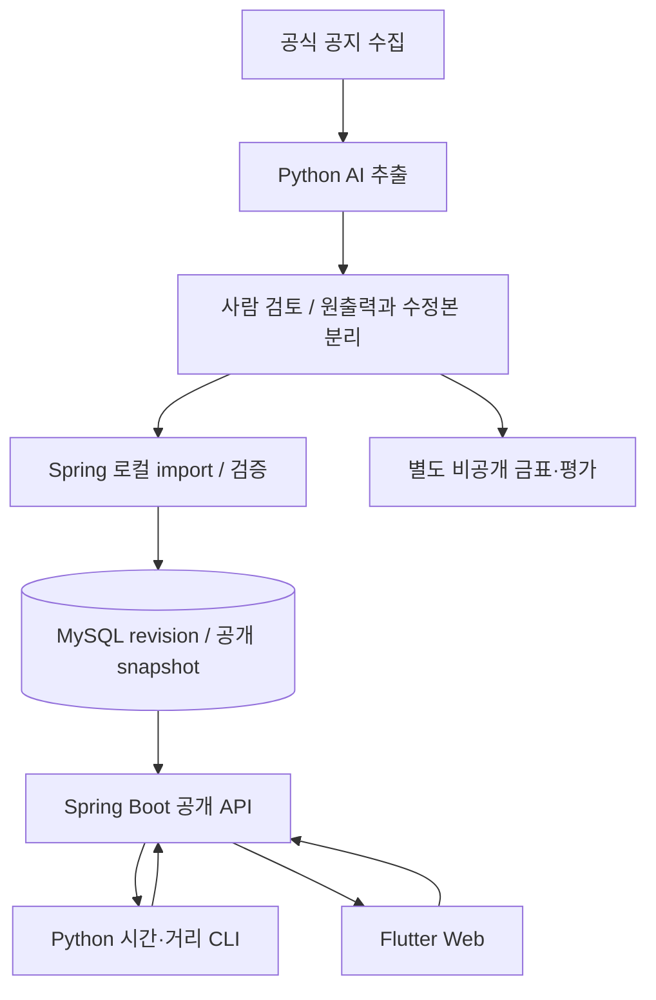

# 04. 계산 규칙·기술·운영 설계

[확정 요구] **여기:it**은 안성시민 전체의 5분야 탐색으로 확장하며 기존 소상공인 기능을 유지한다. Flutter Web·Dart / Java21·Spring Boot3.5.x / MySQL8.4 / Python3.13을 사용한다. Node20+는 자동화용이다. [08 기술 구성](08_기술구성과연결.md), [09 DB 설계](09_DB설계와트랜잭션.md), [10 WBS](10_인원별WBS.md)를 함께 적용한다.

[기존 구현·계약] C01~C10·I01~I03과 아래 3유형·지점·14일·500m·영업시간 규칙은 기존 소상공인 매칭 계약이다. 시민 전체 조회의 고정 조건이나 신규 5분야·자격 판정 알고리즘이 아니다. 예전 11/3·11/4 시연 일정은 [과거 기록]이다. 새 필드/API/오류·개인화·변경 추적과 이번 버전 우선 분야·수집처는 [합의 필요]다. 날짜·사건 예시는 가상이다.

## 시민 조회·필터·상세의 설계 경계

[설계 제안] 신규 목록·검색·필터는 기존 매칭을 우회 호출해 5분야 지원으로 표현하지 않는다. 화면별 데이터 의미를 먼저 합의하고 [03 데이터 확장 설계](03_데이터와AI.md#여기it-확장-데이터-설계)와 API·DB의 대응을 정한다. 아래는 새 경로·JSON 키·enum 확정안이 아니다.

| 조회·표시 | 처리 기준 | 합의할 사항 |
|---|---|---|
| 검색·목록 | 검색어·지역·분야·모집 상태·비용·기간·정렬과 적용 조건·건수 반환 | 검색 대상·복수 선택·중복 공지/사건 집계·페이지·정렬 동률·입력 한도 |
| 지역 | 공지 적용 지역·진행 장소·거주 자격 지역 구분 | 행정구역 단계·전체 선택·미상·지역 자료원; 자동 위치/거리 계산 지원 여부 |
| 5분야 | 교육·배움 / 지원·혜택 / 행사·문화 / 공사·교통 / 생활정보 | 기존 construction/event/traffic 대응·복수 분류·계약 버전·호환성 |
| 신청기간 | 신청 시작·마감의 원문 표현·정밀도·상시/선착순/조기마감 조건 보존 | 날짜만 있는 마감의 시각 의미·기준시각·확인 필요 처리 |
| 진행일정 | 실제 진행 시작/종료·반복·연결 장소를 신청기간과 분리 | 기존 occurrence 재사용 범위·새 스키마·진행기간 필터 |
| 모집/진행/취소 | 신청 마감 ≠ 진행 종료, 취소 ≠ 마감; 출처 확인 상태도 별도 | 모집 상태의 근거·시각/정원에 따른 불확실성·각 미상 표시 |
| 비용 | 명시 무료·금액·조건·부대비용·미기재를 구분 | 조건별 무료/유료·금액 단위·필터·미상 순서; 누락을0원으로 변환 금지 |
| 상세·개인화 | 대상·자격/신청조건·방법·준비사항·지역·출처·근거 제공 | 연령·관심은 탐색 신호이며 자격 확정 금지; 개인화 기준·설정 최소항목 |
| 변경 전후 | 확보한 이전/새 값·근거·확인 시점만 표시 | 수집·차이 검토 주기·관계 확정·미확보 이력의 ‘변경 여부 미확인’ |
| 관심·개인설정 | 초기 프런트 브라우저 보관 | 저장/해제·초기화·실패·오래된 항목·직접 진입; 계정 동기화/새 인증/자동 알림 필수 아님 |

현재 공개3API는 기존 계약 그대로다. 신규 경로·필드·상태는 김윤기·이상헌·남규민이 화면별로 합의한 뒤 계약·fixture·DB 변경·연동 시험에 반영한다. 이 문서 변경은 스키마 버전 변경이나 신규 기능 구현이 아니다. 기존 `candidate/needs_check/cancelled`와 `start/distance`를 신규 모집 상태·관심/마감/진행 정렬의 enum으로 그대로 사용하지 않는다.

[현행 업무] 김윤기 기존 기능 조사 → 이상헌과 화면별 필드/API/오류 합의 → 변경 구현 → 프런트 연동 → 강명묵의 반복 시나리오 검증 → 백엔드 원인 오류 수정 순서로 진행한다. 남규민은 범위·수집처·차별화3후보·개인화·변경 추적·완료 예정일을 조율한다. 3후보의 정확한 명칭·내용은 미제공이며 정보 분석·개인화·이해 지원·신뢰성 4개 관점으로 대체하지 않는다. 새 AI 실행 방식도 후보 범위와 합의한다.

## 계산 결정표

[기존 구현·계약] 이 절과 C01~C10은 기존 소상공인 시간·거리 기능에 적용한다. 시민 목록을 이 결정표에 모두 통과시킨 뒤에만 노출하지 않는다.

한 사건을 candidate(후보), needs_check(확인 필요), cancelled(취소), excluded(선별 제외) 중 하나로 분류한다. 서로 다른 occurrence의 날짜와 장소를 섞지 않는다. **알려진 값만으로 조건 불일치가 확정되면 제외; 필요한 조건이 미상이고 불일치가 확정되지 않으면 확인 필요**가 원칙이다.

| 단계 | 규칙 | 결과 |
|---|---|---|
| 0 | 비공개/미승인/구역 밖/비공식 자료 | public API에 넣지 않음 |
| 1 | current/replay·snapshot 선택, 현행 revision 결정 | 모드 혼합·불확실 정정 자동 적용 금지 |
| 2 | 유형 필터와 각 occurrence의 날짜/공간/영업 조건 평가 | true/false/unknown 3값으로 계산 |
| 3 | 유효 occurrence 하나라도 날짜·공간·영업 true | 후보 가능; 다른 미상 occurrence는 경고 추가 |
| 4 | true 없음, 하나라도 false 없는 unknown 조합 있음 | 확인 필요 |
| 5 | 모든 occurrence가 하나 이상의 false 조건을 가짐 | 제외, 이유 기록 |
| 6 | 취소 확인된 사건 | 후보 불가. 취소 전 승인 조건으로 범위 true/unknown이면 취소 섹션, 모두 false면 제외 |
| 7 | 최신 확인 미충족/관계 충돌/구역 관련성 미확정 | 후보 가능이어도 확인 필요로 강등. 취소 근거 미확인이면 lifecycle=uncertain |

`unknown AND false=false`, `unknown AND true=unknown`, `true AND true=true`; occurrence 간에는 OR. ‘후보’는 시간·직선거리 조건이 맞는다는 뜻이며 도로 방향·진입 가능 여부까지 맞는다고 보증하지 않는다. direction/target 조건은 원문을 보존하고 이용자 확인 warning을 붙인다. 사용자에게 해당 차량/진행 방향 입력을 받지 않으므로 코드가 이를 true로 단정하지 않는다.

## C01 — 시간대·다음 14일

- 업무 시간대 Asia/Seoul. 서버 UTC 시각을 KST로 변환해 날짜 D 산출; 클라이언트 시계는 판정에 사용하지 않는다.
- 기본 정의는 **오늘 포함 14개 달력 날짜**, `[D 00:00, D+14일 00:00)`이다. ‘내일부터 14일’로 읽지 않도록 UI에 ‘오늘 포함’과 시작/마지막 날짜를 표시한다. 기존 계약의 시간창 정의이며 시민 전체 조회의 고정 기간이 아니다.
- 예: D=2026-11-02이면 11-02 00:00 포함, 11-16 00:00 제외. 이미 시작했어도 이 창과 중첩하면 처리한다. 오늘 오전 끝난 사건도 오늘 범위에는 포함하되 ‘오늘 종료’ 배지; 현재 시각을 기준으로 예정/진행/종료를 별도 표시한다.
- 과거 재현은 case.anchor_date를 D로, 시간 상태 표시는 case의 reference instant(기본 D 12:00 KST)로 고정한다. snapshot에는 해당 reference instant도 기록한다.

## C02 — 영업 구간

요일별 구간을 D-1일부터 D+13일까지 생성해 조회창과 교집합한다. 전날 22~익일02시가 첫날 00~02시에 걸치는 경우를 놓치지 않기 위해 D-1을 포함한다. 구간은 `[start,end)`; 겹치거나 맞닿은 영업 구간은 합친다.

09:00~18:00 offset0 정상; 22:00~02:00 offset1 정상. 종료<=시작 & offset0 오류. offset1이라도 총 길이>24h 오류. 동일 시각은 일반 입력에서 오류, full_day=true만 24h 인정. 휴무는 **그날 새로 시작하는 영업 없음**이며 전날에서 이어진 구간은 유지한다. unknown인 날은 ‘영업시간 미입력’; 해당 날짜의 후보는 확인 필요가 될 수 있다.

시간 중첩: `max(startA,startB) < min(endA,endB)`. 경계만 맞닿으면 중첩0, 후보 아님. 중첩 분은 합집합 길이를 구해 중복 합산하지 않는다. 원문 초 단위는 보존하고 계산 후 분 표시는 소수1자리(결정에는 반올림 전 값)로 한다. 분 단위 입력이 기본이다.

## C03 — 사건 날짜·시간·미상

| 원문/상태 | 정규화·선별 |
|---|---|
| 11/1 22시~11/2 02시, 연도 확인됨 | 정확 datetime 구간; 조회창에 들어온 부분만 계산 |
| 11/3~11/5, 시간 미기재 | date_only, 날짜 포함 범위 `[11/3,11/6)`로 날짜 비교만. 영업 중첩은 unknown, 확인 필요. 종일 통제라고 표현 금지 |
| 11/3 하루 종일이라고 명시 | explicit_all_day, `[11/3 00,11/4 00)`; 영업 중첩 계산 가능 |
| 11/3 09~12시 및 14~17시 | 2 occurrences, 점심 시간을 통제로 메우지 않음 |
| 매주 월·수 10~12시, 11/2~11/15 | 검토된 기간·요일로 유한 날짜 전개; 무기한 반복은 보류 |
| 시작만 있고 ‘종료 추후 안내’ | 종료 미상; 아직 진행 중으로 가정하지 않음. 날짜 완결 불가이면 확인 필요 |
| ‘내일’, 게시일·연도 불확실 | ambiguous. 사람의 명확한 근거 없이는 날짜 생성 금지 |
| 연도 없고 다른 본문 문장에 연도 명시 | 사람이 같은 사건임을 확인해 근거 연결 후 정규화; 게시연도만으로 추측 금지 |
| 날짜 범위 전체가 조회창 밖 | 시간 미상이어도 제외 |
| 조회 기간 모두 영업 closed | 시간 미상 사건도 영업 불일치 확정으로 제외; 확인 필요 잔여가 있으면 이유별 표시 |

date_only의 날짜 범위와 영업이 전혀 없으면 false, 영업이 일부 있으면 unknown. 날짜 미상이면 거리 true여도 자동 후보가 될 수 없다.

## C04 — 복수 조건의 결합

occurrence마다 연결된 location_ids를 사용한다. 예: 11/3 A구간, 11/5 B구간인 사건에서 11/3 영업과 B거리만 맞는 것을 후보로 만들지 않는다. 복수 장소 중 하나가 확인된 500m 이내이면 공간 true; 모든 장소가 완전히 확인되어 500m 밖이면 false; 확인 장소는 밖인데 나머지가 미상이면 unknown. 날짜·장소 대응 자체가 모호하면 그 occurrence는 공간 unknown이다.

## C05 — 거리 계산·500m 경계

점-점은 Haversine, 지구 반경 **6,371,008.8m**를 규칙 상수로 고정한다. `a=sin²(Δφ/2)+cosφ1 cosφ2 sin²(Δλ/2)`, `d=2R atan2(√a,√(1-a))`; 부동오차에 대비해 a를 [0,1]로 clamp. 계산 원값 `d<=500.0`이면 포함, 초과면 제외. 임의 여유 반경을 더하지 않는다. 화면은 정수 m 반올림하되 경계 부근(495~505m)은 소수1자리와 ‘기준 500m’ 표시, 비교는 원값 사용.

검토된 도로 선분은 한쪽 끝점만 사용하지 않는다. 각 선분의 최단 대권 구간 거리와 끝점 거리를 비교해 최소값을 구한다. 구현 계약: 단위 구면 벡터 p,a,b; n=normalize(a×b), q=normalize(p−(p·n)n), q와 −q 중 짧은 호 a→b 위에 있는 투영점은 R·acos(clamp(p·q)); 나머지는 min(d(p,a),d(p,b)). 호 포함은 `|angle(a,q)+angle(q,b)-angle(a,b)|<=1e-10 rad`. 동일 끝점은 점거리, 반대편/퇴화 구간은 검토 오류. 여러 선분 최소값이 거리다. 이는 검토된 선형 geometry에 대한 거리이고 실제 도로 접근 경로가 아니다.

정류장 집합은 검토된 점들까지 최소 거리. geometry가 전체 구간을 포함하지 않는 partial이면 확인된 점이 이내일 때 true 가능, 밖이라는 이유로 false 확정 금지. 영역(area)·불명 구간은 geometry만으로 임의 중심점 거리 판정하지 않고 unknown. 좌표 검토 때 원문과의 대응·정확도 한계를 기록하며 **‘직선 500m는 후보 검색 기준’**을 표시한다.

## C06 — 구역·주소·지명·방향

구역은 사람이 관련성을 분류한다. verified area 안이고 거리 미상인 자료는 확인 필요 섹션에 노출한다. area uncertain은 ‘구역 관련성도 확인 필요’로 표시하고 후보 집계 제외. outside는 공개 조회 제외. 구역 경계 바깥 사건이라도 시험 지점 500m 안에 해당할 수 있으므로 ‘시범 구역 관련성’은 공지 발생 지점의 행정경계만으로 결정하지 않는다.

지명 사전 정확한 명칭/검토된 동의어만 연결. 여러 후보·개명·같은 도로 이름이면 사람 검토. 노선/정류장/운행 방향/대상 차량은 구조화 값과 원문 근거 표시. ‘시청 방면 변경, 반대 방면 제외’는 두 정보를 함께 표시하고 ‘전면 통제’로 요약하지 않는다. 인접한 가게라고 적용 대상에 포함됐다고 계산하지 않는다.

## C07 — 정정·취소·중복

사람이 확인한 관계 그래프 순서로 현행 revision 결정. 게시일이 나중이라는 이유만으로 대체하지 않는다. 정정 문서는 변경한 필드만 덮고 유지 필드는 이전 근거를 계속 참조한다. 덮어쓴 필드에는 새 근거가 필요하다. 충돌하고 우선관계 불명확하면 lifecycle uncertain·확인 필요, 임의 최신값 선택 금지.

취소 확인은 현행 후보에서 즉시 제거하고 취소 섹션으로 이동. 취소 전 기간·장소는 ‘취소 전 안내’로 명시하며 범위 조회에만 사용한다. 재게시·중복은 event_id 하나로 연결해 카드 1개; 문서별 링크와 변경 이력 유지. 취소 뒤 재개는 명확한 공식 재개 근거를 검토해야 active로 복귀한다. 수정 중에는 이전 승인본을 유지하되 새로운 변경 의심이 발견되면 stale/needs_check로 표시한다.

## C08 — 최신 확인 상태

[설계 제안] 현재 모드에서 각 현행 필드의 출처 문서가 성공 확인된 지 **24시간 이하**, 이후 check_result가 changed/unreachable/uncertain이 아니면 확인 유효. 정확히24h는 유효, 초과면 needs_check와 ‘마지막 원문 확인 ○○, 최신 상태 재확인 필요’. 이는 팀 운영 주기 제안이며 신뢰도 보증이나 프로그램 기준이 아니다.

재현 모드는 같은 정책을 case의 고정 `reference_instant`에 적용해 당시 조회와 같은 판정을 만든다. 당시 확인 기록은 knowledge_cutoff까지로 제한한다. 실제 조회 시각이 나중으로 바뀌어도 재현의 경과 시간·판정은 고정된다. 현재 원문 연결·확인 상태는 별도 current_* 필드로 보존한다.

실제 재확인은 수동으로 현재 안내 게시 전·실증 직전에 수행한다. HTTP200만으로 내용·취소 상태까지 확인됐다고 기록하지 않는다. 링크 단절은 오류 정보와 마지막 성공 시각을 유지한다. 공개 100% 목표의 ‘최종 확인 시각’은 last_verified_at이지 snapshot 생성 시각이 아니다. 성공 확인이 한 번도 없으면 공개 불가. 외부 원문이 끊겨도 링크와 이전 확인 사실을 삭제하지 않고 확인 필요로 표시한다.

이미 근거를 확인해 cancelled인 사건은 24h 경과만으로 active/후보가 되지 않는다. 취소 섹션을 유지하고 ‘취소 확인 이후 최신 상태 재확인 필요’를 붙인다. 취소 자체의 근거가 충돌/오류로 판명되었을 때만 lifecycle=uncertain으로 옮긴다. 수동 확인 결과가 바뀌면 새 snapshot을 공개해야 웹에 반영된다. 24h 경과 여부는 요청 시 서버가 계산하므로 재배포 없이도 경과 경고가 발생한다.

## C09 — 동시간대 묶기

후보 중 exact_time 또는 explicit_all_day만 대상으로, 조회창∩영업시간∩사건구간으로 잘라 이벤트 시작/종료점을 sweep한다. 같은 시각에서는 종료를 먼저 반영하여 접점0 중첩을 만들지 않는다. 활성 **고유 사건**이 2개 이상인 구간을 묶고, 인접 구간의 사건 집합이 같으면 합친다. 날짜만 있거나 확인 필요 상태인 사건은 확정 동시간 묶음에 넣지 않는다.

예: A 10~12, B 11~13, C 12~14 → A+B 11~12, B+C 12~13. A+B+C가 함께 겹친다고 표시하지 않는다. 묶음 ID는 snapshot+조건 hash+시작/종료+정렬 event_ids에서 결정. 각 사건 카드 수에는 영향을 주지 않는다.

## C10 — 과거 재현

case별 anchor_date·reference instant·knowledge_cutoff·입력 문서 버전을 고정한다. 당시 이용 가능했던 것으로 확인된 문서만 사용하고 이후 정정/취소를 소급 적용하지 않는다. 그 당시 원문 버전을 확보하지 못한 경우 ‘현재 확보한 자료로 재구성한 과거 사례’라고 표시하고 당시 실시간 정확도 평가에서 제외한다. 재구성 사례는 기능/현재 확보본 추출 시험에는 사용할 수 있으나 구분 보고한다. 재현에도 시험 직전 현재 원문 연결 상태를 확인하되 이 시각은 당시 지식 cutoff와 별도 필드로 표시한다. current의 24h 경과를 replay의 사건 발생일과 비교하지 않는다.

## 확정 기술 구성

[확정 요구] **Flutter Web·Dart 프런트 / Spring Boot·Java 공개 API / MySQL 작업·공개 DB / Python AI·계산**을 유지한다. 기존 알고리즘 C01~C10과 D/I/T 계약을 보존하며 새 시민 조회·AI 확장은 합의 후 별도 구현한다.

- Flutter Web은 모바일 우선 반응형 UI와 PC 화면을 제공한다. 네이티브 앱은 별도 합의 대상이다. AI/Figma 시안 검토·피드백과 화면 확정 후 Flutter를 구현한다. [Flutter Web FAQ](https://docs.flutter.dev/platform-integration/web/faq), [웹 빌드](https://docs.flutter.dev/deployment/web)
- Spring Boot가 공개 API I01~I03, 검토본 import, DB 트랜잭션·공개 snapshot 선택을 담당한다. JDK21과 Spring Boot3.5.x를 구현 기준으로 두고 실제 패치·Gradle Wrapper를 고정한다. [Spring Boot 요구사항](https://docs.spring.io/spring-boot/3.5/system-requirements.html)
- MySQL8.4 LTS·InnoDB를 사용한다. 공개 전 검토·버전·snapshot을 분리하고, 생성/갱신에는 트랜잭션과 충돌 검사를 적용한다. 세부 구조는 [09 DB 설계](09_DB설계와트랜잭션.md). [MySQL LTS 안내](https://dev.mysql.com/doc/refman/8.4/en/mysql-releases.html)
- Python3.13의 시간·거리 계산 모듈을 단일 원본으로 유지한다. Spring은 [계산 연결 계약](../../contracts/calculation-bridge.md)의 JSON stdin/stdout CLI를 호출한다. Python 공개 웹서버나 Java/Dart의 별도 계산 구현을 추가하지 않는다.
- [기존 구현·계약] AI 추출은 Python 일괄 처리이며 기존 공개 조회에서 AI를 호출하지 않는다. 사람 검토본을 Spring 로컬 import에 전달하고 Python은 MySQL에 직접 쓰지 않는다. 신규 AI 실행 방식은 차별화3후보 최종 범위와 함께 합의한다.
- Asia/Seoul은 Python zoneinfo를 사용하며 Windows에는 tzdata 의존성을 명시한다. [Python zoneinfo](https://docs.python.org/3/library/zoneinfo.html)

위 공식 문서 링크의 기존 확인 기록은 2026-11-02다. 환경·포트·명령·장애 처리는 [08 기술 구성](08_기술구성과연결.md)과 각 모듈 README를 따른다. [기존 구현·계약] 백엔드 공개3API·MySQL·검토본 import·승인/미리보기/공개/복구·snapshot 내보내기와 Python C01~C10 CLI·연결을 구현했다. 합성 검증과 실제 승인·운영을 구별한다. `frontend/`는 README/TASK만 추적되며 Flutter 구현·시민5분야 API·실제 프런트 연동 완료 상태가 아니다. 기존 npm build는 합성 HTML만 패키징한다.

## 인터페이스 계약

[기존 구현·계약] 아래 공개I01~I03·JSON 의미는 기존 소상공인 버전이다. 새 목록·검색·필터 API의 최종 경로가 아니다. 로컬I10/I11은 요약이며 실제 등록/수정/승인/공개 명령과 입력은 [로컬 관리 API](../../backend/docs/local-management-api.md)를 따른다. I12는 공개 endpoint가 아닌 로컬 평가 작업이다.

모든 공개 응답은 `{schema_version,snapshot_id,generated_at,data}`. 실패는 `{error:{code,message,field_errors,retryable},request_id}`. 시간 UTC, 화면 KST. 미상 number는 null, 0으로 치환 금지. 성공은200, 입력오류422, 미등록404, 버전충돌409, 데이터 미준비503, 예상치 못한 오류500. 오류 응답에 traceback/본문/키 금지.

| ID | 인터페이스 | 요청 | 성공 응답·권한 |
|---|---|---|---|
| I01 | GET `/api/v1/config?mode=current` 또는 `mode=replay&case_id=…` | mode/case_id | D01의 공개5지점, days14/radius500/timezone, server_now, D07 공개 metadata·case 목록. public read |
| I02 | POST `/api/v1/matches` | D02 + selection(candidate/needs_check/cancelled), sort(start/distance), 선택 snapshot_id | query_context(anchor/window/point/hours), 세 상태 counts, 선택 상태 items, overlap_groups, rule_version. 조건은 저장 안 함 |
| I03 | GET `/api/v1/events/{event_id}?snapshot_id=…` | 공개 사건ID·snapshot | 현행 공개 D06·필드별 근거·문서 링크·변경이력. 사용자 계산은 I02의 해당 event 결과를 함께 표시 |
| I10 | 로컬 POST `/local/documents`, `/local/extractions/import` | D03 문서 입력 / D05 출력파일·expected_input_hash | 생성 ID·검증오류·review 상태. 자동 공개 없음 |
| I11 | 로컬 PUT `/local/events/{id}/review`; POST `/local/publish` | expected_revision_no·수정필드·근거 / 승인 revision 목록·mode | 새 revision 또는 검증된 snapshot 경로·checksum. 충돌409 |
| I12 | 로컬 `evaluate/export` 내부 작업 | dataset/gold/runs/task records 버전 | 자동·수정후·규칙·최초·재시험 구분 CSV/JSON 결과. 공개 endpoint 아님 |

I02 classification/reason codes: WINDOW_OUTSIDE, BUSINESS_CLOSED, TIME_NO_OVERLAP, DISTANCE_OUTSIDE, DATE_UNKNOWN, TIME_UNKNOWN, BUSINESS_UNKNOWN, LOCATION_UNKNOWN, AREA_UNCERTAIN, SOURCE_STALE, SOURCE_UNREACHABLE, RELATION_UNCERTAIN, CANCELLED. false로 제외된 사유는 팀 시험 로그에서 확인하고 공개 기본 목록에는 내보내지 않는다. 상태 counts는 유형 필터 적용 후 selection 이전 고유 사건 수다. 정렬 규칙은 S02를 따른다. overlap_groups는 후보 집합만 사용한다.

I02 응답 item 필수: event_id/revision_id/title/types/classification/reason_codes/warnings/occurrences/locations/applicability/exceptions/source_refs/distance_m/distance_basis/time_overlap_minutes/matched_occurrence_ids/lifecycle. source_refs는 title/url/published_date/last_verified_at/check_result. 상세 계산과 목록 계산은 같은 응답 객체를 재사용하고 Dart에서 별도 판정하지 않는다.

공개 서버에는 `/local` 라우터를 등록하지 않는다. 로컬 관리 프로세스는 별도 `local-api` 프로필·127.0.0.1 bind·임시 Bearer 토큰·실제 포트와 같은 Host/Origin 검사를 유지한다. forwarded 헤더로 경계를 대체하지 않는다. 토큰은 소스/URL/로그에 넣지 않는다. 관심·개인설정 추가를 이유로 이 경계를 완화하지 않으며 새 인증·다중 관리자 계정은 이번 자동 필수가 아니다.

### API 경계·검증 보완

- I02 selection 기본 candidate, sort 기본 start. 주간영업7요일 모두 있어야 하며 미입력은 unknown 객체. 서버는 조건을 정규화한 후 응답 query_context에 반환한다. 14일/500m는 서버 config 상수다.
- I03은 조건 없는 사실 응답이다. 직접 진입 후 지점을 선택하면 I02 재조회에서 해당 event의 분류를 얻는다. 제외되어 items에 없으면 ‘현재 선택 조건의 후보에 포함되지 않음’으로 표시하며, 임의로0m/0분을 채우지 않는다.
- 알 수 없는 snapshot은404, 이미 폐기된 공개 snapshot은409 `SNAPSHOT_RETIRED`와 현행 snapshot_id를 반환한다. 사용자가 새 버전 적용을 선택한 뒤 다시 조회한다. 복구/평가용 이전본은 비공개 보관한다.
- 기존 로컬 JSON 관리8MiB, 원문 업로드20MiB·multipart전체21MiB·metadata64KiB, 최종 본문200,000 Unicode code point 등은 [관리 API](../../backend/docs/local-management-api.md)·[원문 업로드](../../backend/docs/source-upload.md)의 실제 경로별 한도를 따른다. AI 파일 업로드는 [별도 계약](../../backend/docs/extraction-upload.md)의 control/metadata/input/prompt/output 한도를 사용한다. 서로 다른 한도를 통합하지 않는다. 초과는413, txt/pdf/json 텍스트화만 허용하고 임의 실행파일/매크로 처리는 하지 않는다. 신규 시민 API의 입력 한도는 별도 합의한다.
- 기존 공개 요청본문 최대32KiB, 기존 계약에 없는 추가키 거부. 새 시민 필드를 기존 요청에 합의 없이 추가하지 않는다. 모든 대상/예외는 반환하고 리스트용 축약 필드로 대체하지 않는다. 금표·raw_output·reviewer 개인정보·private path는 공개 직렬화에서 제외한다.

## 개발·배포·운영

개발 구조: `frontend/`(Flutter 예정), `backend/`(Spring), `processing/`(Python), `contracts/`, `data/private/`, `data/public/`, `evaluation/private/`, `docs/`. 테스트는 각 모듈의 실제 폴더·README를 따른다. 공개 저장소에서는 private 경로·.env·실명 자료 제외. 개발용 dev 데이터와 holdout 데이터 접근 경로 분리. 프런트는 확정 시안과 합의한 fixture로 구현하고 실제 공지로 바꿀 때 출처·검토/공개 조건과 합성 표시 제거 조건을 검사한다. 새5분야 예제를 기존 JSON 계약의 구현 실적으로 기록하지 않는다.

[설계 제안] Flutter 구현 후 `build/web/` 전체를 연구실의 별도 앱 실행 환경에 배치하고 Spring Boot API로 연결한다. 개발은 Flutter5173·Spring8080·MySQL3306을 기준으로 하되 실제 포트 충돌은 조정한다. 배포는 정적 자산과 API의 동일 origin 구성을 목표로 하며 현재 연구실 운영 설정은 수정하지 않는다. Python은 Spring이 같은 실행 환경에서 호출할 수 있어야 한다. 실제 URL·base path·Python 경로·DB 접근을 남규민이 확인한다.

[현행 업무] 단계별 완료 예정일은 팀과 합의한다. 이전 연구실 PC 시연 목표를 현재 일정으로 재사용하지 않는다. 신규 범위는 조사 결과·확정 화면·필드/API/오류 합의·구현·실제 연동·명묵의 반복 검증 결과·원인 수정으로 인수한다. [05 새 범위 인수](05_시험과인수기준.md#여기it-새-범위-인수)의 Y01~Y10은 합의 후 기대 결과를 고정하는 설계 초안이다. PC·모바일/실기기와 운영 배포는 실제 수행한 범위만 기록한다. 가상 응답·Sites 시제품·HTML 미리보기는 실제 Flutter/API·DB·Python 연결이 아니다. 별도 관리 UI를 새 필수 게이트로 추가하지 않으며 [로컬 HTML 검토 보고서·명령](../../backend/docs/review-report.md)으로 동등한 검토를 수행할 수 있다.

AI 키·DB 비밀번호는 서버/로컬 처리 환경에만 둔다. Flutter의 dart-define과 웹 번들에는 비밀키를 넣지 않는다. 기존 AI 공급자 호출은 승인된 일괄 처리 작업에서만 실행하고 공개 조회에서 호출하지 않는다. 신규 AI 호출 방식은 차별화 후보 범위·개인정보·비용을 합의한 뒤 결정한다. 입력 공식 URL은 허용 자료원 검사 후 사람이 수집하므로 공개 API에 임의 URL fetch 기능을 만들지 않는다. 본문·AI 문자열은 Flutter 텍스트 위젯으로 표시하며 HTML/스크립트로 실행하지 않는다.

기존 공개 순서: 문서 검토 → 현행 관계 확정 → 승인 revision 추출 → 기존 스키마·링크·5지점·표시 검사 → 불변 snapshot과 checksum 준비 → MySQL 트랜잭션에서 snapshot·구성 revision 저장 및 현재 포인터 교체 → commit → 공개 화면 점검. 실패하면 rollback하여 이전 포인터 유지. JSON 내보내기는 commit 후 수행하며 파일 저장과 DB commit을 하나의 원자적 작업으로 주장하지 않는다. 이전 snapshot으로 포인터를 복구하고 복구 시각/이유를 기록한다. 조회는 처음 선택한 snapshot ID를 끝까지 사용한다. 클라이언트는 API network 응답을 다시 확인하며 오래된 snapshot을 최신이라고 캐시하지 않는다. 시민 확장에서도 이 승인·원자적 공개·실패 보존 경계를 재사용하되 새 분야·필드의 공개 조건은 계약 합의 후 적용한다. 변경 이력 미확보는 ‘변경 여부 미확인’으로 표시한다.

로그: request_id·error code·latency·snapshot/rules version만 기본 기록; 사용자 영업시간 본문·IP 장기 분석·개인식별 로그는 수집하지 않는다. 검토 파일은 revision 이력, 출판은 snapshot hash, 평가는 고정 버전으로 복구한다. 잘못된 공개를 발견하면 해당 사건 비공개/확인 필요 처리 → 수정·교차검토 → 새 snapshot → 재시험. 취소 누락은 우선 수정한다.

## PWA 선택 검토

우선 모바일 브라우저의 전체 흐름을 완성한다. 이후 manifest·아이콘·설치 안내와 HTTPS를 추가하고 실제 iOS/Android에서 확인한다. 설치 조건·지원은 브라우저별로 달라 단일 설치 버튼이 모든 환경에서 작동한다고 가정하지 않는다. [MDN 설치 가능한 PWA 안내](https://developer.mozilla.org/en-US/docs/Web/Progressive_web_apps/Guides/Making_PWAs_installable)

추가 작업: 아이콘/manifest, 설치 후 경로·뒤로 가기, 업데이트 안내, 설치 환경별 확인. 서비스워커 오프라인 공지 캐시는 선택 후속이며 기본안에는 넣지 않는다. 도입 시에도 오래된 자료를 현재 안내로 보여주지 않도록 시각·오프라인 경고가 필요하다. 푸시/스토어 등록/네이티브 앱은 이 선택만으로 필수화하지 않는다.
