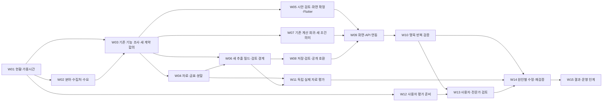

# 06. 개발 작업 목록·실행계획

갱신일 **2026-11-17 (Asia/Seoul)**. 여기:it의 현행 업무는 11/16 백엔드 업무지시서와 최신 사용자 결정을 따른다. [00 공통 표기·우선순위](00_목차.md#문서의-표기와-우선순위), [10 WBS](10_인원별WBS.md)를 함께 읽는다. 11/3 인계·11/4 시연과 이전 역할은 과거 기록이며 현재 마감·담당 지시가 아니다.

## 진행 방식

**기존 기능 조사→이번 버전 범위·화면/API 합의→변경 구현→상헌 연동→명묵 반복 시나리오 검증→백엔드 원인 오류 수정** 순서다. 김윤기가 백엔드 재사용·변경을 맡고, 남규민이 우선 분야·수집처·개인화·변경 추적·일정을 조율한다. 단계별 완료 예정일·검토자는 실제 담당자와 정한다. 문서 갱신만으로 구현·연동·평가를 완료 처리하지 않는다.

기존 공개 API3개·MySQL·Python 계산·검토/공개/복구·평가 도구를 조사해 재사용/수정/추가 표에 남긴다. 기존 원문·AI 원출력·사람 수정·승인·snapshot·실패·revision·출처 경계를 유지한다. 새 5분야·검색·모집/비용/기간 필터와 필드는 합의·호환 변경 대상이다. 초기 특정 집단 검증과 시민 전체 서비스 범위를 구분한다.

W01~W15는 기존 추적 ID다. 순번만으로 착수일·완료율을 추정하지 않는다.

## 작업별 담당·완료 기준

| ID | 작업·구체 산출물 | 현행 담당 / 협업 | 선행 / 완료 게이트 |
|---|---|---|---|
| W01 | 코드·자료·연동·섭외·가용시간 현황과 미결정 목록 | 남규민 / 전원 | 현재 사실·이전 기록·예정 분리, 단계별 완료 예정일 합의 |
| W02 | 5분야 우선 범위·실제 수집처·이용조건·시민 수요·초기 검증 집단 | 남규민 / 김윤기·이상헌·강명묵 | W01. 소상공인 기능 유지, 5지점/500m를 전체 서비스 제한으로 사용하지 않음 |
| W03 | 기존 기능·브랜치/코드 위치·실행/API 현황, 재사용/수정/추가 표와 화면별 필드·오류 계약 | 김윤기 / 이상헌·남규민 | W01/W02. 목록·상세·검색·필터 의미·미확인 값·버전 호환 합의, 3후보 정확한 내용 확인 |
| W04 | 실제40문서 목표 목록·원문hash·관계·dev20/holdout20·독립 금표 | 남규민 조율 / 작성·교차검토·튜닝 담당 별도 지정 | W02/W03. 기존 자료와 새 분야 표본 구분, 그룹 누출0·노출 이력·금표 봉인 |
| W05 | AI/Figma 시안 검토·피드백·화면 확정 후 통합 메인/분야별 목록/지역·관심 탐색/상세 Flutter 구현 | 이상헌 / 김윤기·남규민 | W03. API 필드·로딩/실패/빈상태·접근성 합의, fixture/실제 구분 |
| W06 | 기존 AI 추출·근거·실패 보존 재사용, 새 신청/자격/비용/기간 필드의 추출·검토 설계 | 김윤기 변경 범위 정리 / 남규민과 실행 담당 합의 | W03 및 W04 개발용 확보분. 새 AI 실행방식은 최종 3후보 범위와 합의, 원출력 불변 |
| W07 | C01~C10·기존 소상공인 시간/거리 회귀, 새 모집·신청/진행·비용·정렬 의미 구현 범위 | 김윤기 / 강명묵 반복 검증 | W03. Python 단일 원본 유지, 미기재≠무료·신청마감≠진행종료, 새 필드/enum 임의 확정 금지 |
| W08 | MySQL·import·사람 검토/승인·snapshot·복구의 재사용/확장 | 김윤기 / 강명묵·남규민 | W03/W06. 기존 Flyway/원본 불변, 새 migration·호환·백업/복구 계획, S10 동등 보고서·명령 허용 |
| W09 | 합의한 목록·상세·검색·필터 API와 Flutter 연결, 실제 응답·오류·미확인 값 | 김윤기·이상헌 / 남규민 | W05/W07/W08. 합성/실제·기존/신규 구분, 실제 호출과 연결 결과 기록 |
| W10 | 동일 데이터·초기화·환경으로 정상/누락/마감/종료/취소 반복 시나리오 | 강명묵 / 김윤기·이상헌 | W09. 기존 T01~T23·C01~C10·DB01~DB11·IN01과 새 Y01~Y10 분리, 기대/실제·증빙·재현 기록 |
| W11 | 규칙/AI/사람 수정 비교·독립 최초 평가·선별 오류 분해 | 남규민 조율 / 평가·튜닝·교차검토 담당 분리 | W04/W06/W07. 40/20·20·8필드90% 유지, 새 분야/필드·분모 적용 사전 합의·최초 결과 보존 |
| W12 | 사용자6명 목표·최소3명 평가 추진, 과제·동의/보존·파일럿·서식4 | 남규민 / 전원·자문 후보 | W01부터 평가연계 병렬. 시민 과제와 기존 소상공인 과제 구분·실증 전 프로토콜 고정 |
| W13 | 실제 사용자 과제·전문가 검토·D09·비식별 증빙 | 남규민 / 강명묵·이상헌 | W10/W12. 실제 참가/실패·자료 재확인, 전문가/파일럿을 사용자 수에 합산하지 않음 |
| W14 | 원인별 오류 배정·김윤기의 백엔드 수정·화면 담당 수정·명묵 재검증·서식5 | 원인 기능 담당 / 강명묵·작성자 외 검토 | W10/W11/W13. 이전 결과·수정 전후·재현 조건 보존, 주요 오류0·미달 사유 보고 |
| W15 | 재사용 현황표·API 명세·코드/PR·데이터 적용법·반복 검증 자료·사용안내·서식6/7 | 김윤기 등 산출물 담당 / 남규민 취합 | W14. 실행법·환경설정 이름·제약·미완료·운영 종료/기록 처리, 비밀값/실제 평가 기록 제외 |

W04가40건 완료되기 전에도 개발용 확보분으로 W06을 진행할 수 있다. 확인용은 튜닝에 사용하지 않는다. W05는 합의된 가상 응답으로 진행하되 시안을 실제 API 연동으로 세지 않는다. 기존 세 유형 회귀와 시민 대상 새 범위 인수를 모두 남긴다.

## 단계 게이트와 기존 일정의 연결

| 게이트 | 충족 조건 | 일정 기록 |
|---|---|---|
| G0 조사·합의 | W01~W03, 기존 기능표·우선 분야/수집처·3후보 대응·화면/API·미확인 의미 | 담당·예정일 팀 합의 |
| G1 변경·연동 | 합의한 조회/상세·필터·새 필드·호환 저장, 실제 화면/API 호출 | 담당·예정일 팀 합의 |
| G2 반복 검증·실증 준비 | 명묵 재현자료·기존/새 인수, snapshot·동의/과제·참여/장소·서식4 | 미실행 항목과 일정 합의 |
| G3 평가·개선 | 독립 실제 자료/사용자 평가·원인 수정·재검증, 목표와 실제 분리 | 실제 확보·가용시간 반영 |
| G4 공유·인계 | 결과·한계·영상/안내·서식6/7·실행/복구·남은 작업 | 행사·제출일 확인 후 기록 |

이전10월 회기·11/3 인계·11/4 시연·11월 실증·12월 공유 주차는 당시 계획이다. 실제 이행·확정 행사일을 추정하지 않는다. 새 업무에는 단계별 완료 예정일을 다시 합의한다. 각25%는 초기 노력 배분 목표이며 실제 예상/투입 공수·진척 수치가 아니다.

## 병목과 대응

| 병목 | 대응 | 요청할 결정·지원 |
|---|---|---|
| 새 범위·3후보 내용 미확정 | 기존 기능 조사·시안 검토·회귀 유지, 4개 AI 구체화 제안은 후보 대응표에 분리 | 남규민과 후보3개 정확한 내용·이번 버전 완료 기준 합의 |
| 새 분야 실제 자료 부족 | 수집처·권리·대표성 검토, 기존47문서 처리 기록을 5분야 평가로 전용하지 않음 | 분야별 자료·표본·분할·새 필드 평가 적용 합의 |
| API/화면 의미 불일치 | 상헌과 필드·신청/진행·비용미상·모집 상태·오류 예시 먼저 맞춤 | 김윤기 계약·호환 변경표, 명묵 반복 시나리오 |
| AI 계정/실행 방식 미확정 | 기존 보관·검토/import 재사용, 지원/비용 확인 전 새 실행 완료로 쓰지 않음 | 최종 후보 범위·데이터 조건·담당 합의 |
| 좌표·대상·변경 이력 애매 | 검토된 근거만 표시, 자격 자동 확정·없는 변경 전후 생성 금지 | 지명·구간·정책 담당 자문 후보에게 확인 요청 여부 결정 |
| 관리 UI 지연 | S10 동등 로컬 HTML 보고서·명령으로 원문/AI/수정값·오류·승인·미리보기 제공 | 별도 관리 화면을 새 필수 인수 조건으로 추가하지 않음 |
| 참여자·일정/배포 미확정 | 시민 유형·기기·센터 평가연계 확인을 병렬 진행, 개발환경 핵심 흐름 검증 | 섭외·운영·외부 URL·main 반영은 실제 상태와 분리 |
| 확인용 오염 | 개발/확인 분리·독립 금표·최초 결과 보존, 노출 이력 보고 | 추가 독립 자료 확보, 목표20건 임의 감축 금지 |

## 센터·멘토에 가져갈 구체 자료

- 범위: 5분야와 이번 우선 수집처, 초기 검증 집단·시민 과제, 기존 소상공인 기능 유지 표.
- 기술: 재사용/수정/추가 표, 화면/API 필드·오류·미확인 예시, 실패 추출·계산 경계·검토/공개 자료.
- 자문 후보: 안성e지도 데이터 담당, 안성시 청년정책·교육문화/복지/주거 분야, 지역 시민단체, 시민활동통합지원단. 섭외·협약 확정으로 쓰지 않는다.
- 현장/운영: 실제 과제·동의·모집/장소·기기·보존/접근, RT·실증·성과공유 실제 날짜와 제출 기준.

팀이 구현·검토 주체이며 자문 후보에게 대리 제작을 전제하지 않는다. 기존 지원금 계획100만원(도구30/조사30/인쇄15/공유25)은 승인액·집행 실적이 아니다.

## 프로그램 산출물 연결

| 양식 | 활용할 자료 | 실제 작성 시점 |
|---|---|---|
| 서식1 문제정의서 | 01 시민 문제·범위·기존 기능 유지, 이전 v1.0 | 최신 방향 반영·제출 여부 확인 |
| 서식2 RT 계획서 | 07 합의 필요·자문 후보·확인할 질문 | 개최/제출일 확인 |
| 서식3 RT 수정 활동계획서 | 실제 피드백·결정·W 담당/일정 | RT 후 제출 기준 확인, 피드백 창작 금지 |
| 서식4 실증 활동 계획서 | 05 프로토콜·실제 모집/장소·시민/기존 과제 | 실증 전 |
| 서식5 실증 결과 요약서 | 실제 지표·실패·의견→수정·증빙2장 | 실증·보완 후 |
| 서식6 자율활동 내역서 | W별 실제 회의·작업·결정·증빙 | 수시 기록, 제출 주기 확인 |
| 서식7 최종 결과물 소개서 | 합의한 핵심 기능·AI 구조·실제 결과·화면·URL/파일 | 성과공유 전 |

셰르파 멘토링 내역서는 멘토 정산 문서이며 팀 필수7종에 추가하지 않는다.

## 개발자에게 넘길 구현 순서

1. [11 착수](11_개발착수가이드.md)→[08 기술](08_기술구성과연결.md)→[10 WBS](10_인원별WBS.md)→담당 README/TASK를 읽고 현행 업무와 과거 기록을 구분한다.
2. 김윤기는 기존 API·DB·Python·검토/평가 도구의 코드 위치·실행·재사용/변경 범위를 조사한다.
3. 남규민과 범위·수집처·3후보 대응을, 상헌과 화면/API·필터·미확인·오류를 합의한다. 시안 검토·피드백 후 화면을 확정한다.
4. 합의한 변경과 필요한 호환 migration을 구현하고 상헌과 실제 API를 연결한다. 관심/설정은 초기 브라우저 저장, 새 인증·동기화·알림 자동 추가 없음.
5. 명묵에게 동일 데이터·초기화·환경·기대 결과를 전달해 기존/새 시나리오를 반복 검증한다.
6. 김윤기는 백엔드 원인 오류를 수정하고 명묵이 같은 조건으로 재검증한다. 실제 평가·운영 인수는 별도 증빙으로 남긴다.
7. 결과·실행법·제약·미완료를 인계한다. 새 API/enum·진척률·예정일·섭외 실적을 임의 확정하지 않는다.
