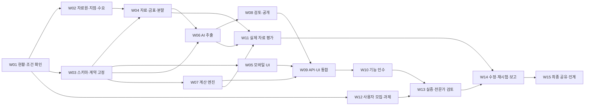

# 06. 개발 작업 목록·실행계획

> 이 파일은 전체 MVP 명세입니다. **11/3(화) 오후6시 인계·11/4(수) 연구실 PC 시연**의 우선 작업은 [화면 시연 작업 기준](../wednesday-screen-brief.md)을 따릅니다. 전체 기능·정량 목표는 유지합니다.

> 수요일 공유 버전의 실행 분담은 [저장소 README](../../README.md)와 [수요일 실행안](../wednesday-plan.md)을 우선합니다. 이상헌=프런트, 강명묵=백엔드, 김윤기=AI, 남규민=통합·배포 조율입니다. 아래 전체 명세의 장기 역할표와 구분합니다.

기준일 **2026-11-02 (Asia/Seoul, 제공된 현재 환경 기준)**. 원계획의 10월 회기들은 이미 지난 계획이며 실제 완료 여부는 확인되지 않았다. 이번 작업에서 확인된 결과는 문서 작성까지다. 저장소 구현·공지 확보·섭외 실적은 추정하지 않는다.

## 진행 방식

날짜를 먼저 약속하지 않고 작업 의존성과 완료 게이트를 고정한다. 팀별 가용 시간과 실제 진척을 받은 뒤 아래 작업의 남은 노력·담당 가능한 날짜·센터 행사 날짜로 일정을 계산한다. 각 작업의 ‘상태/실제 완료일/증빙 링크’는 착수 회의에서 채운다. 기본 상태는 미확인이다.

## 작업별 담당·완료 기준

| ID | 작업·구체 산출물 | 담당 / 교차 검토 | 선행 / 완료 게이트 |
|---|---|---|---|
| W01 | 현재 코드/자료/섭외/팀 가용시간 표, 실제 RT·실증·성과회 일정, 미결정 목록 | 남규민 / 전원 | 없음. 사실과 예정 구분, 빈칸은 미확인 표시 |
| W02 | 시범구역1·기준지점5·좌표근거·자료원 이용범위, 최근 공지확인 경험 인터뷰 요약 | 강명묵·남규민 / 남규민 | W01. 장소·자료원 검토, 불편 없음도 기록 |
| W03 | D/I/C 계약·JSON 검증 스키마·가상 fixture·버전 규칙·UI 상태표 | 김윤기·이상헌 / 강명묵·남규민 | W01. 세 유형·예외 전부 표현 가능, 07 결정 기본안 기록 |
| W04 | 실제 공지40 목표 목록, 원문hash, 사건관계, dev20/holdout20, 금표·판정 기준 | 강명묵 / 김윤기(dev), 남규민(holdout) | W02/W03. 실제확보와 목표 구분, 같은그룹 누출0, 금표 봉인 |
| W05 | S01~S04 모바일 화면·PC 대응·오류/빈상태·원문 이동 | 이상헌 / 남규민 | W03. 가상자료로 T01/T02/T15/T18/T19, 가상라벨 유지 |
| W06 | AI 요청/결과 파일 흐름·승인 도구 adapter·프롬프트·근거 검사·실패 로그 | 김윤기 / 강명묵 | W03 및 W04의 개발용 확보분. 실제개발자료로 세유형 확인, 원출력보존 |
| W07 | Python 시간/거리/관계/중첩 모듈, C01~C10 단위 시험 | 김윤기 / 강명묵·남규민 | W03. 정상·경계·예외 기대값 검증, 시간미상/좌표미상 분리 |
| W08 | S10 로컬 검토·수정·승인, SQLite/JSON 저장·snapshot 생성·rollback | 이상헌(도구)·강명묵(운영) / 김윤기 | W03/W06. 미검토공개차단, field근거·수정이력, 공개마이그레이션 확인 |
| W09 | I01~I03 통합·현재/과거 분리·동시간 묶음·출처상태 | 이상헌 / 김윤기·남규민 | W05/W07/W08. 세유형 핵심흐름 실제자료로 끝까지 동작 |
| W10 | T01~T23 실행 기록, 실기기·원문연결·복구·비밀키 검사 | 이상헌 / 남규민 | W09. 주요오류0, 미실행은 통과로 기록 금지 |
| W11 | 금표/규칙/AI/사람수정 비교·최초보고서·선별오류 분해 | 강명묵·김윤기 / 남규민 | W04/W06/W07. 확인용 동결, 분모·생성·실패 포함 |
| W12 | 사용자6명 목표 평가연계 현황표, A/B 과제·순서·동의/보존·파일럿·서식4 | 남규민 / 강명묵·멘토 자문 요청 | W01부터 센터 평가연계 협조 확인 병렬, W04 자료 기준 과제 확정. 실증 전 프로토콜 고정 |
| W13 | 사용자 직접 과제·전문가 검토·D09 기록·비식별 증빙 | 남규민 / 강명묵 | W10/W12. 최소3명 평가 추진, 실제유형/실패 포함, 최신원문 재확인 |
| W14 | 오류 우선순위·수정 전후·재시험·서식5·실제목표 달성표 | 해당 기능 담당 / 최초작성자 외 검토 | W11/W13. 최초결과보존, 치명/주요오류 해결, 미달사유 보고 |
| W15 | 웹시제품·공개 가능한 코드/설정/지명사전·실제자료목록/금표/오류·사용자결과·영상/안내서·서식6/7 | 남규민 / 전원 | W14. 재실행 안내·운영 종료/기록처리·제출목록 확인 |

W04가40건 완료되기 전에도 확보한 **개발용**으로 W06을 진행할 수 있다. 확인용은 분리한다. W07은 가상 경계 사례, W05는 동일 계약의 가상 API 응답으로 병렬 진행한다. W12의 센터 평가연계 협조 확인은 개발 완료를 기다리지 않는다. 세 유형은 공통 데이터·규칙·UI를 먼저 만들고 유형별 fixture로 확인하되 모두 W09/W10 인수 조건에 포함한다.

## 단계 게이트와 기존 일정의 연결

| 게이트 | 충족 조건 | 원계획과의 연결 (확정 일정 아님) |
|---|---|---|
| G0 착수 기준 | W01~W03 핵심 계약·담당·남은시간 확인 | 기존10월3~4주 계획의 실제 이행 여부 확인 |
| G1 핵심 통합 | 세유형 입력→추출→검토→5지점/시간 선별→원문, C예외 동작 | 최신 S2의11월1~2주 제안과 연결 |
| G2 실증 준비 | 기능인수·자료snapshot·동의/과제·참여자/장소·서식4 | 11월2주 준비 제안, 센터 제출일 확인 |
| G3 실증·개선 | 실제공지평가·사용자평가·주요오류수정·재시험 | 기존11월3~4주 목표 유지, 실제가용시간으로 재산정 |
| G4 공유 | 결과·한계·영상/안내서·서식6/7·재실행자료 | 12월1주 계획, 행사 확정일 확인 |

추정 공수를 실제 가용시간처럼 쓰지 않는다. 착수 회의에서 담당자가 W별 남은 작업을 시간 단위로 추정하고 병렬 가능한 일/검토 대기를 구분한다. 목표 날짜에 맞지 않으면 공통 모듈 재사용·교차검토 시간 예약·센터/멘토 병목 지원·행사 전후 제출 가능일 협의를 우선한다. 범위 변경을 적용한 계획은 작성하지 않았다.

## 병목과 대응

| 병목 | 범위를 유지하는 대응 | 요청할 지원·결정 |
|---|---|---|
| 현재 공지 부족 | 같은구역 과거수집기간 확대, 현재/재현 분리, 문서/사건 구분 | 강명묵 자료원 후보 → 센터 공식채널 안내 요청 |
| AI 계정/API 미확정 | 로컬 schema/검토/파일 import부터, 승인 지원도구 수동 추출 가능성 확인 | 남규민 도구조건·입출력·한국어품질·비용 확인 |
| 위치/방향 애매 | 지명사전 공동검토, partial/unknown 명시, 구간을 점으로 축약 금지 | 현장전문가에 구간·노선 확인 자문 |
| 김윤기에 AI+계산 집중 | 시간·거리 규칙 계약 먼저 고정, 이상헌이 API 연결, 강명묵가 근거/금표 검토 | 멘토에는 실패입력·시도·기대값을 묶어 자문 요청 |
| 관리 UI 지연 | 동일 검증 계약의 파일 import/export와 승인표로 운영 가능, 이력·공개 게이트 유지 | UI 편의 순서 조정만; AI/검토 기능 제거 아님 |
| 사용자 모집 지연 | 모집 즉시 병렬, 소상공인 우선·센터연계 요청·가능 일정 여러개 수집 | 참여 확정 전 기관협약/섭외완료 표현 금지 |
| 배포 환경 미확정 | 팀PC·시험기기에서 완전한 핵심흐름 검증, Python 호스팅 조건 요청 | 외부 서비스 URL 공개/상시운영은 별도 확정 |
| 확인용 오염 | 별도금표관리·개발용만 튜닝·최초결과잠금 | 노출시 한계보고·추가독립자료 확보, 20목표 임의감축 금지 |

관리 파일 방식으로 전환하더라도 S10에서 요구하는 원문/AI/수정값 비교, 검증 오류, 승인 기록, 공개 미리보기는 동등한 로컬 보고서·명령 결과로 제공해야 한다. 이는 구현 방법의 대안이며 추가 승인 흐름을 사용자에게 강요하는 절차가 아니다. 기본안은 로컬 검토 화면이다.

## 센터·멘토에 가져갈 구체 자료

- 자료원·구역: 후보 구역 지도 설명, 기준5지점 좌표근거, 세유형 공지 샘플, 수집/재배포 이용 조건 표.
- 기술: 실제 실패 추출1~3건과 근거, C03/C05/C07 경계표, 공개 전 검토표, 모델 입력/출력 조건 확인 항목.
- 현장: 세 사용 시나리오·모바일화면·A/B 과제·참여안내·지원희망 장소/기기·모집 일정.
- 운영: RT 개최일·3일 전 계획/3일 후 수정계획 제출, 실증/성과회 날짜, 담당 창구·멘토 일정, 예산 승인/지급/증빙.

팀이 구현·검토 주체이고 멘토에게 대리 제작을 요구하지 않는다. 지원금 계획100만원(도구30/조사30/인쇄15/공유25)은 승인액이 아니며 유료 구매·선지급을 일정의 전제로 두지 않는다.

## 프로그램 산출물 연결

| 양식 | 본 명세에서 활용할 자료 | 실제 작성 시점 |
|---|---|---|
| 서식1 문제정의서 | 01 문제·가설·범위, 기존 v1.0 | 최신안 보유, 제출 여부 확인 |
| 서식2 RT 계획서 | 07 미결정·센터자문, 기존 v1.0 | 개최/제출일 센터 확인 |
| 서식3 RT 수정 활동계획서 | 실제 받은 피드백·결정·W별 담당/일정 | RT 후3일 기준 확인, 피드백 창작 금지 |
| 서식4 실증 활동 계획서 | 05 프로토콜·실제 모집/장소·질문 | 실증 전 |
| 서식5 실증 결과 요약서 | 실제지표·실패·의견→수정·증빙2장 | 실증 및 보완 후 |
| 서식6 자율활동 내역서 | W별 회의·작업·결정·증빙 | 수시기록, 종료취합/제출주기 센터확인 |
| 서식7 최종 결과물 소개서 | 기능3개·AI구조·실제결과·화면2~3장·URL/파일 | 성과공유 전 |

셰르파 멘토링 내역서는 멘토의 정산 문서이며 팀 산출물7종에 추가된 팀 필수 보고서로 취급하지 않는다.

## 개발자에게 넘길 구현 순서

1. 00~07을 읽고 결정 기본안·요구사항 ID를 작업 이슈에 연결한다.
2. D/I 스키마와 가상 데이터, C 경계시험부터 고정한다.
3. 모바일 조건→목록→상세를 fixture로 구현하면서 Python 계산을 병렬 개발한다.
4. 수집·AI 파일 처리·검토·승인·snapshot 흐름을 연결한다.
5. 세유형 실제개발자료로 통합하고 현재/과거·중복/취소·동시간묶음을 검증한다.
6. 기능인수·확인용 최초평가·현장 준비 후 사용자 비교를 실시한다.
7. 수정/재시험·결과표·인계 자료를 완성한다. PWA와 부가 기능은 이후 여력을 확인해 별도 결정한다.
