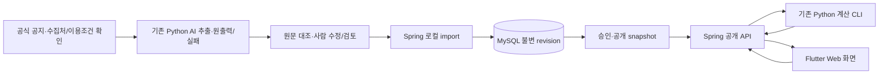

# 08. 확정 기술 구성·개발환경·연결

갱신일2026-11-18. 여기:it의 확정 기술은 유지한다. [00 표기·우선순위](00_목차.md#문서의-표기와-우선순위)와 [11 착수](11_개발착수가이드.md)를 따른다. 기존 구현·시민 조회 구현 검토안·화면별 최종 합의를 구분하며 실제 검증·미완료는 모듈 README·PR 증빙을 따른다.

## 구성과 책임

| 영역 | 기준·현재 자산 | 현행 책임 |
|---|---|---|
| 사용자 화면 | Flutter Web / 번들 Dart. 추적 파일은 README·TASK이며 앱 코드 없음 | 이상헌 시안 검토/피드백·화면 확정 후 구현, 김윤기와 API 연동 |
| 공개 API | Java21 / Spring Boot3.5.x / Gradle Wrapper. 기존 API3개·공통 오류·Python 연결 | 김윤기 기존 기능 조사·재사용/변경·화면/API 합의·백엔드 오류 수정 |
| 시민 조회 구현안 | 같은 시민 공개본의 목록·상세·확보된 공개/철회/복구 이력. Python/AI·원문 파일 미호출 | 김윤기 구현·검증, 이상헌과 최종 화면 계약 대조는 후속 |
| 데이터 저장 | MySQL8.4 LTS / InnoDB / Spring JDBC·Flyway(JPA 미사용) | 김윤기 기존 문서·추출·revision·검토/공개/복구 경계 재사용·호환 확장 |
| AI 처리 | Python3.13 추출·근거/실패·원출력·사람 수정·평가 도구 | 기존 자산 유지. 새 필드·실행방식/담당은3후보 범위와 합의 |
| 시간·거리 계산 | Python 순수 함수·JSON CLI, C01~C10·calc-v1 | 기존 계산 단일 원본 유지, 김윤기 변경 영향 정리·강명묵 반복 검증 |
| 반복 시나리오 검증 | 같은 데이터·초기화·환경의 정상/누락/마감/종료/취소·오류 | 강명묵 반복 실행·기대/실제·재검증 기록 |
| 기획·범위·통합 | 분야·수집처·개인화·변경 추적·일정·평가/운영 조율 | 남규민, 실제 가용시간·완료 예정일 팀 합의 |

이전 강명묵 백엔드/김윤기 AI 역할과11/3~4 시연 일정은 과거 기록이다. 기술 버전은 실제 빌드 파일·lock·각 README 기준으로 고정한다. Flutter 구현 시 SDK·번들 Dart·`pubspec.lock`·상태관리/HTTP 패키지 선택과 실제 명령을 기록한다. 신규 라이브러리·공개 Python 서버·네이티브 앱을 자동 추가하지 않는다. Node.js20+는 자동화용이며 앱 런타임이 아니다.

## 두 개의 처리 흐름



[기존 구현·계약] AI는 수집/갱신 때 별도 실행하고 공개 조회 중 호출하지 않는다. Spring은 승인 snapshot과 조건을 Python 계산기에 전달한다. Java/Dart에 별도 후보·시간/거리 판정을 만들지 않는다. Python은 MySQL에 직접 쓰지 않고 Spring이 import·DB 검증·공개 권한을 맡는다. 새 AI 실행방식은3후보 최종 범위와 합의하며 기존 공개/비공개 경계를 약화하지 않는다.

공개 프로세스에 `/local`을 등록하지 않는다. 로컬 관리 HTTP는 별도 `local-api` 프로세스·127.0.0.1 bind·loopback 원격주소·Bearer·실제 port의 정확한 Host/Origin을 검사한다. `localhost`나 forwarded 헤더로 이 검사를 대체하지 않는다. 시민용 새 인증이 없어도 이 관리 경계는 유지한다. 자세한 실행·한도는 [로컬 관리 API](../../backend/docs/local-management-api.md)를 따른다.

## 폴더와 인계 경계

```text
frontend/       Flutter Web 구현 예정·화면/DTO/API client 책임
backend/        기존 Spring·JDBC·Flyway·공개/로컬 관리·Python adapter
processing/     기존 추출·원본 보관·계산 CLI·평가 도구
contracts/      적용 중인 기존3유형 API·JSON·계산/검토/평가 계약
data/public/    검토 후 공개 가능한 교환 JSON·예제
data/private/   Git 제외: 원문·AI 작업본·선택 백업
evaluation/private/  Git 제외: 실제 평가 기록(도구별 private 경로는 계약 참조)
docs/spec/      현재 설계·인수·DB·WBS·실행 기준
docs/reference/ 이전 근거·합성 HTML(현행 앱/연동 결과 아님)
```

기존 API는 `GET /api/v1/config`, `POST /api/v1/matches`, `GET /api/v1/events/{event_id}?snapshot_id=…`다. 기존 요청은 지점·영업시간·`construction/event/traffic`와 현재/과거 모드를 사용한다. [contracts](../../contracts/README.md), [03](03_데이터와AI.md), [04](04_계산규칙과기술설계.md)의 기존 필드·null·상태·UTC·ID를 유지한다.

[시민 조회 구현 검토안](../../contracts/citizen-api.md)은 별도 `GET /api/v1/citizen/notices`와 `GET /api/v1/citizen/notices/{eventId}?snapshot_id=…`다. 생성/확인 시각과 원문 FieldValue·미상을 보존하고 같은 불변 시민 공개본에서 목록/상세·확보 이력을 읽는다. 읽기 전용 DB·같은 자료 종류의 이력·공통 오류/요청 로그·기존 API 호환을 검증하며 최종 화면·검색/필터/정규화 합의는 남아 있다.

[설계 제안·합의 필요] 시민용 목록·상세·검색, 지역·5분야·모집 상태·비용·기간·정렬과 신청조건/방법/준비사항 등은 기존 API3개에 구현된 것으로 세지 않는다. 김윤기·상헌이 실제 화면별 계약과 오류/미확인 의미를 맞추고 남규민과 범위를 확정한다. 경로·필드·enum·버전 호환과 [DB 확장 단계](09_DB설계와트랜잭션.md#여기it-확장과-호환-마이그레이션)를 합의한 뒤 변경한다. 신청/진행을 분리하고 미기재 비용을 무료로 바꾸지 않는다.

## 개발 환경과 실행

| 항목 | 적용 기준 | 현재 의미 |
|---|---|---|
| Flutter | 구현 시 포트·`API_BASE_URL` 읽기 방식·빌드 명령 기록 | 기존5173은 설계 예시. Flutter 앱/API 연결 구현 완료 아님 |
| Spring 공개 | 기본 localhost:8080, 기존 `/api/v1` | fixture 합성 실행과 public DB 실행 분리 |
| MySQL | localhost:3306·전용 개발 DB `myai_dev` 기본 | 기존 연구실/운영 DB 사용 금지, 실제 설정은 README 참조 |
| Python | Spring 자식 프로세스·Python3.13·동일 버전 소스 | 별도 공개 포트 없음, JAR에 Python 소스/실행 파일 미포함 |
| 로컬 관리 | 별도 `local-api`, 127.0.0.1:8081 기본 | 토큰·Host/Origin 등 필수 설정, 공개 프록시 연결 금지 |

아래는 **기존 구현의 실행법**이다. 새 시민 API·Flutter·실제 운영 연결을 입증하지 않는다. DB 생성·자격정보·보관 root·관리 토큰은 [백엔드 README](../../backend/README.md)의 해당 절차로 별도 준비한다. 비밀값은 문서·클라이언트·로그에 남기지 않는다.

```bash
# 저장소 루트: DB 없는 합성 API
./backend/gradlew -p backend bootRun --args='--spring.profiles.active=fixture'

# 저장소 루트: 기존 Python 계산 CLI의 합성 입력
python3.13 -m processing.matching < processing/examples/match-input.json
```

DB 공개 프로세스는 준비된 `DB_URL`·`DB_USERNAME`·`DB_PASSWORD`와 Python 설정을 받는다. `MYAI_PYTHON_WORKDIR`는 저장소 루트 절대 경로, `MYAI_PYTHON_EXECUTABLE`은 실제 Python3.13 실행 파일이다. `./backend/gradlew -p backend bootRun`이 기존 기동 명령이며 Windows는 `gradlew.bat`을 사용한다. `.env` 작성만으로 Java 환경변수가 등록되지 않는다. public은 DB/Flyway로 기동하며 fixture/seed로 자동 대체하지 않는다. 공개 전 config503은0건 성공이 아니다.

로컬 관리의 필수 `MYAI_LOCAL_API_*`와 보관 경로·파일 권한은 [전용 안내](../../backend/docs/local-management-api.md#실행-준비)를 따른다. 실제 포트/계정 충돌은 환경설정으로 처리하고 실행 디렉터리·기동/정지·예제/실제·연결 상태를 인계한다. 문서만 보고 공유/운영 DB에 초기화·시험을 실행하지 않는다.

## Flutter Web 구현 기준

- 모바일 한 열을 먼저 완성하고 PC에서는 읽기 폭과 상세 배치를 조정합니다. LayoutBuilder/MediaQuery 등으로 실제 제약을 읽어 배치하며 폰 화면을 PC에서 과도하게 늘리지 않습니다.
- DTO·repository/API client·상태·화면을 구분합니다. fixture/실제 HTTP만 교체하고 화면 코드를 별도로 복제하지 않습니다. 상태관리 패키지 선택과 버전은 이상헌이 기록합니다.
- 웹 지원 HTTP 패키지와 원문 링크 처리를 사용합니다. `dart:io` 기반 네트워크·로컬 파일 접근을 웹 경로에 넣지 않습니다.
- 기본 URL 전략은 브라우저 hash 경로로 시작하고 뒤로가기·직접 진입·새로고침을 확인합니다. 조건·필터 복원 상태와 snapshot을 함께 유지합니다. path 전략으로 바꾸면 서버 fallback을 포함해 시험합니다.
- 시각은 서버 UTC→Asia/Seoul로 표시합니다. 이용자 기기의 다른 시간대에서 KST 표시가 바뀌지 않게 합니다. 후보 판정은 Python 결과를 사용합니다.
- 접근성은 Semantics·초점·키보드·상태 텍스트·확대·줄바꿈으로 확인합니다. 원문과 긴 근거는 선택·복사 가능한 표시를 검토합니다. Python code point offset과 Dart UTF-16 인덱스를 혼용하지 않습니다.
- 원문 열기는 사용자 클릭에서 실행하고 새 탭임을 안내합니다. 브라우저에서 실패하면 URL 확인/복사 등 복구 수단을 제공합니다.

## 연구실 시연과 후속 배포

11/4 연구실 PC 시연은 과거 목표다. 현재는 조사→계약/화면 합의→변경→연동→반복 검증→오류 수정 단계별 완료일·실행 환경을 팀과 합의한다. 기존 [웹시제품](https://yeogi-it-neighborhood.kmnam001.chatgpt.site/)은 합성 공지·원문 예시·기존 백엔드 미연결을 안내한다. [Figma](https://www.figma.com/design/lM2PFXTrzaJmLqbkVp4gUO)는 검토 대상이며 확정 화면·구현 증거가 아니다. 기존 `npm run build`도 합성 HTML 패키징이며 Flutter 빌드가 아니다.

관심 저장·개인 설정은 초기 프런트 브라우저 저장 기준이다. 저장 범위·초기화·기기 동기화 없음 안내를 합의한다. 새 인증·계정 동기화·알림 발송·자동 위치/거리 계산은 시제품 UI만으로 구현 필수/완료가 되지 않는다. 연령·관심 정보만으로 신청 자격을 확정하지 않는다.

Flutter 구현 후 릴리스 산출물은 `flutter build web`의 `build/web/` 전체다. 희망 배포 경로 `/myai/team/`와 외부 API 후보 `/myai/team/api/v1`은 현재 배포 사실이 아니다. 실제 SDK/API client·base href·자산·프록시 접두사·브라우저 이력·새로고침을 환경에 맞춰 검증한다. 정적 자산/API는 같은 origin을 목표로 하고 개발 CORS는 정확한 허용 origin을 사용한다. MySQL·Python·관리 API는 공개 웹 경로에 노출하지 않는다.

운영 중인 연구실 소개/관리 서비스는 변경하지 않는다. 운영 경로·외부 URL·배포는 환경 확인과 팀 합의를 거치며 `main` 반영은 사람 검수 대상이다. 설치/개발 실행·실제 API 연동·사용자 평가·운영 인수를 각각 기록한다.

## 오류와 연결 시험

- Flutter→Spring: 합의한 정상/빈결과/미확인·422·404·409·503·500을 실제 DTO로 확인한다. 신규 검색/필터 경로·필드·상태는 계약 합의 후 추가한다.
- Spring→Python: timeout·비정상 종료·잘못된 JSON·snapshot/버전 불일치. 실패를0건·고정 예제·Java 판정으로 대체하지 않는다.
- JSON→MySQL: 검토/근거 오류·중복 import·revision 충돌·공개 중단에서 이전 공개본과 원출력 보존. 새 필드 호환 migration·복구 검증.
- 반복 시나리오: 명묵이 같은 자료·초기화·환경에서 정상/누락/신청마감/진행종료/취소를 재실행한다. 김윤기 백엔드 오류 수정 후 같은 조건으로 재검증한다.
- 기존 T01~T23·C01~C10·DB01~DB11·IN01과 새 Y01~Y10·실제 자료/사용자 평가는 [05](05_시험과인수기준.md)로 구분한다. S10 동등 로컬 보고서·명령 방식은 유지한다.

## 공식 근거

기존 링크 확인일2026-11-02. 이번 갱신에서 재조회하지 않았다. 버전·기능 참고이며 현재 프로젝트 설치·호환/새 범위 시험 증거가 아니다.

- [Flutter Web FAQ](https://docs.flutter.dev/platform-integration/web/faq): 웹 앱·브라우저·웹 플랫폼 제약.
- [Flutter 웹 빌드·배포](https://docs.flutter.dev/deployment/web), [네트워킹](https://docs.flutter.dev/data-and-backend/networking).
- [Spring Boot3.5 요구사항](https://docs.spring.io/spring-boot/3.5/system-requirements.html): Java·빌드 도구 호환 범위.
- [MySQL LTS 릴리스](https://dev.mysql.com/doc/refman/8.4/en/mysql-releases.html), [InnoDB 트랜잭션](https://dev.mysql.com/doc/refman/8.4/en/innodb-transaction-model.html).
