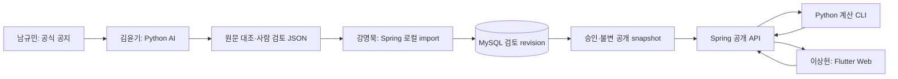

# 08. 확정 기술 구성·개발환경·연결

버전v1.1 · 2026-11-02 · 기술 구성은 사용자 결정, 아래 세부 연결·버전 범위는 구현 기준입니다. 실제 설치·기동·성능 검증 결과는 아직 없습니다.

## 구성과 책임

| 영역 | 기준 | 담당 | 책임 |
|---|---|---|---|
| 사용자 화면 | Flutter Web / Dart | 이상헌 | 반응형 조건·목록·상세·안내, API 호출, 브라우저 이력·원문 |
| 공개 API | Java21 / Spring Boot3.5.x / Gradle Wrapper | 강명묵 | I01~I03, 입력/출력 검증, snapshot 선택, Python 호출 |
| 데이터 저장 | MySQL8.4 LTS / InnoDB / Spring Data JPA / Flyway | 강명묵 | 문서·추출·revision·검토/공개 이력·DB 마이그레이션 |
| AI 처리 | Python3.13 | 김윤기 | 일괄 추출·근거 검사·원출력·사람 검토 JSON |
| 시간·거리 계산 | 동일 Python 환경의 순수 함수·JSON CLI | 김윤기 | C01~C10, 분류·거리·중첩·동시간 묶음 |
| 자료·통합·연구실 실행 | 위 구성의 실행·인계 조율 | 남규민 | 공식 샘플·규격·첫 통합·실행 위치·시연 |

Flutter stable의 한 버전을 팀 기준으로 고정하고 번들 Dart를 사용합니다. `flutter --version`·pubspec.lock을 남깁니다. Spring은 실제 Boot 패치와 호환 Gradle8.x Wrapper를 빌드 파일에 고정하며 JDK21에서 빌드·실행을 확인합니다. MySQL8.4 패치와 Python 패치·의존성도 기록합니다. 이 문서가 임의 최신 버전 설치 또는 테스트 완료를 뜻하지 않습니다.

프런트 개발환경은 Flutter SDK·번들 Dart와 Chrome을 기준으로 합니다. Android/iOS 네이티브 빌드와 스토어 배포는 후속 확장 대상입니다. 사용 중인 편집기·OS는 같을 필요가 없으며 실행 명령과 의존성을 재현 가능하게 인계합니다.

## 두 개의 처리 흐름



AI 추출은 자료가 갱신될 때 일괄 실행합니다. 사용자 조회에서는 Spring이 승인된 snapshot과 조건을 Python 계산기에 전달합니다. AI 공급자 호출·사람 검토·DB 수정은 사용자 조회 경로에 넣지 않습니다. Java나 Dart에 별도 후보 판정·시간/거리 엔진을 만들지 않습니다.

Python은 MySQL에 직접 쓰지 않습니다. 검토 JSON의 import·DB 검증·공개 권한은 Spring이 맡습니다. 공개 API와 로컬 관리 API는 실행 프로필 또는 별도 프로세스로 분리하고 공개 앱에는 `/local`을 등록하지 않습니다.

## 폴더와 인계 경계

```text
frontend/       Flutter Web 프로젝트·Dart DTO·화면·API client
backend/        Spring Boot·JPA·Flyway·공개/로컬 프로필·Python adapter
processing/     AI 일괄 처리·검토 파일·순수 계산 모듈·matching CLI
contracts/      공통 공개 API·예제 JSON·계산 CLI 연결 계약
data/public/    검토 후 공개 가능한 교환 JSON·예제
data/private/   비공개 원문·AI 작업본·DB 백업 (Git 제외)
evaluation/private/  금표·실제 평가 기록 (Git 제외)
docs/spec/      전체 제품·UX·데이터·계산·시험·DB·WBS·실행 기준
```

API 필드·상태·null·UTC 시각·ID 계약은 [03](03_데이터와AI.md), [04](04_계산규칙과기술설계.md), [contracts](../../contracts/README.md)를 사용합니다. 기술 교체 때문에 공개 JSON을 변경하지 않습니다. DTO 구현 언어만 Dart/Java/Python으로 달라집니다.

## 개발 환경과 실행

| 항목 | 기본 개발값 | 주의 |
|---|---|---|
| Flutter 웹 | localhost:5173 | 개발용 Chrome 실행, fixture/실제 API 모드를 구분 |
| Spring 공개 API | localhost:8080/api/v1 | 현재 공개 API 계약과 동일 |
| MySQL | localhost:3306, 전용 개발 DB `myai_dev` | 기존 연구실 DB·계정을 재사용한다고 가정하지 않음 |
| Python 계산 | Spring의 로컬 자식 프로세스 | 별도 공개 Python 웹서버·포트 없음 |
| Spring 로컬 관리 | 별도 local 프로필, 127.0.0.1:8081 제안 | 토큰·동일 origin 검사, 공개 프로필에서 라우터 미등록 |

실제 포트·DB·계정은 충돌 여부를 확인하고 환경설정으로 변경합니다. 연구실 Jupyter의 HTML 미리보기·정적 파일 열기는 앱/API/DB의 기동 확인과 구분합니다.

프로젝트 생성 후 구현할 실행 절차의 예시입니다. 현재 저장소에 아래 앱·명령이 구현되어 있다는 뜻은 아닙니다.

1. 강명묵: MySQL 전용 개발 DB/계정 준비 → Flyway migration → Spring 기동·API 확인.
2. 김윤기: Python3.13 가상환경·버전 고정 의존성 → 계산 CLI 단독 입력/출력 확인 → 검토본 준비.
3. 이상헌: `flutter pub get` → `flutter run -d chrome --web-port 5173 --dart-define=API_BASE_URL=http://localhost:8080/api/v1`로 개발. API client에서 해당 설정을 읽도록 구현.
4. 남규민: 위 명령을 인계받아 연구실 실행 환경에서 재현·연결 확인. 실제 기동 주소·작업 디렉터리·프로세스 종료/재시작법 기록.

Spring 목표 명령은 Windows `gradlew.bat bootRun`, Linux `./gradlew bootRun`입니다. Python 목표 CLI는 저장소 루트에서 `python -m processing.matching`이며 stdin/stdout 계약을 따릅니다. 실제 인터프리터 경로와 작업 디렉터리는 Spring 설정으로 지정합니다.

환경변수 이름 제안: `DB_URL`, `DB_USERNAME`, `DB_PASSWORD`, `PYTHON_EXECUTABLE`, `PYTHON_WORKDIR`, `CALC_TIMEOUT_SECONDS`, `APP_PROFILE`. Flutter의 `API_BASE_URL`·`DATA_MODE`는 공개 설정입니다. AI 키는 Python 일괄 처리 환경에만 둡니다. 비밀번호·키 값은 저장소·카톡·클라이언트 설정에 넣지 않습니다.

## Flutter Web 구현 기준

- 모바일 한 열을 먼저 완성하고 PC에서는 읽기 폭과 상세 배치를 조정합니다. LayoutBuilder/MediaQuery 등으로 실제 제약을 읽어 배치하며 폰 화면을 PC에서 과도하게 늘리지 않습니다.
- DTO·repository/API client·상태·화면을 구분합니다. fixture/실제 HTTP만 교체하고 화면 코드를 별도로 복제하지 않습니다. 상태관리 패키지 선택과 버전은 이상헌이 기록합니다.
- 웹 지원 HTTP 패키지와 원문 링크 처리를 사용합니다. `dart:io` 기반 네트워크·로컬 파일 접근을 웹 경로에 넣지 않습니다.
- 기본 URL 전략은 브라우저 hash 경로로 시작하고 뒤로가기·직접 진입·새로고침을 확인합니다. 조건·필터 복원 상태와 snapshot을 함께 유지합니다. path 전략으로 바꾸면 서버 fallback을 포함해 시험합니다.
- 시각은 서버 UTC→Asia/Seoul로 표시합니다. 이용자 기기의 다른 시간대에서 KST 표시가 바뀌지 않게 합니다. 후보 판정은 Python 결과를 사용합니다.
- 접근성은 Semantics·초점·키보드·상태 텍스트·확대·줄바꿈으로 확인합니다. 원문과 긴 근거는 선택·복사 가능한 표시를 검토합니다. Python code point offset과 Dart UTF-16 인덱스를 혼용하지 않습니다.
- 원문 열기는 사용자 클릭에서 실행하고 새 탭임을 안내합니다. 브라우저에서 실패하면 URL 확인/복사 등 복구 수단을 제공합니다.

## 연구실 시연과 후속 배포

수요일은 연구실 개발환경에서 PC 브라우저로 시연합니다. 외부 도메인·휴대폰 외부 접속·운영 서버 설정 변경을 수요일 필수 조건으로 두지 않습니다. 정확한 시연 시각·실행 URL은 아직 미정입니다.

Flutter 릴리스 산출물은 `flutter build web`의 `build/web/` 전체입니다. index.html 한 파일만 전달하지 않습니다. base href를 실제 경로에 맞추고 자산·API URL·브라우저 이력·새로고침을 확인합니다. 후속 후보 `/myai/team/`으로 빌드한다면 `flutter build web --base-href /myai/team/ --dart-define=API_BASE_URL=/myai/team/api/v1` 형태를 실제 SDK와 API client에서 검증합니다.

정적 자산과 Spring API는 같은 origin으로 연결하는 구성을 목표로 합니다. 개발용 localhost:5173→8080은 정확한 origin만 허용하는 CORS 설정을 사용합니다. Spring context path와 프록시 경로 제거/유지를 한 가지로 합의해 접두사가 중복되지 않게 합니다. Python·MySQL·관리 API는 공개 웹 경로에 노출하지 않습니다.

현재 운영 중인 연구실 소개/관리 서비스는 변경하지 않습니다. 별도 개발 앱의 실행 조건 확인과 실제 운영 프록시 변경은 구분합니다. 실행 환경에서 Java·MySQL·Python이 가능한지 남규민이 확인하고 실행/미실행 사실을 기록합니다.

## 오류와 연결 시험

- Flutter→Spring: 정상·빈결과·422·404·409·503·500을 같은 DTO/오류 계약으로 표시합니다.
- Spring→Python: 정상·timeout·비정상 종료·잘못된 JSON·snapshot/버전 불일치를 검사합니다. 실패 시 고정 예제나 Java 계산으로 조용히 대체하지 않습니다.
- JSON→MySQL: 검토 미완료·근거 불일치·중복 import·동시 수정·공개 중단에서 이전 공개본을 보존합니다.
- 시연: 예제 응답 화면 / MySQL 실제 저장 / Python 실제 계산 / 실제 AI 추출 건수 / 미구현을 구분합니다.

최종 T01~T23과 정량 목표는 [05 시험](05_시험과인수기준.md)에 그대로 유지하며 [DB·연결 추가 시험](09_DB설계와트랜잭션.md)을 함께 수행합니다.

## 공식 근거

확인일2026-11-02. 버전·기능 근거이며 실제 프로젝트 설치·호환 시험 결과는 아닙니다.

- [Flutter Web FAQ](https://docs.flutter.dev/platform-integration/web/faq): 웹 앱·브라우저·웹 플랫폼 제약.
- [Flutter 웹 빌드·배포](https://docs.flutter.dev/deployment/web), [네트워킹](https://docs.flutter.dev/data-and-backend/networking).
- [Spring Boot3.5 요구사항](https://docs.spring.io/spring-boot/3.5/system-requirements.html): Java·빌드 도구 호환 범위.
- [MySQL LTS 릴리스](https://dev.mysql.com/doc/refman/8.4/en/mysql-releases.html), [InnoDB 트랜잭션](https://dev.mysql.com/doc/refman/8.4/en/innodb-transaction-model.html).
