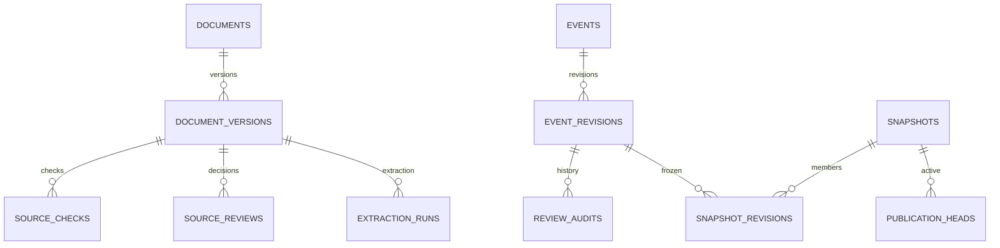

# 09. MySQL DB·트랜잭션·공개 설계

버전v1.1 · 담당 강명묵 · 검토 김윤기·남규민. V1 기초·V2 공개 감사·V3 D05 metadata·V4 원문 확인/사용권 운영 이력 migration과 실제 MySQL 트랜잭션 시험을 구현했습니다. 실행 범위와 미완료는 backend/README.md를 따릅니다. 전체 D01~D09 모델의 필드를 생략하기 위한 축소안이 아닙니다.

## 저장 원칙

MySQL8.4 LTS·InnoDB·utf8mb4를 사용합니다. UUID는 초기 구현에서 CHAR(36) 등 하나의 형식으로 고정하고 ID/hash 비교는 대소문자 규칙을 명시합니다. 시각은 UTC의 DATETIME(6) 등으로 고정하고 DB session·JDBC·JSON 직렬화까지 UTC로 확인합니다. 웹 표시는 KST입니다. 날짜/영업시간 로컬 값은 D02/D06 계약대로 별도 보존합니다.

관계·ID·상태·버전·공개 포인터는 테이블 열로 관리하고 복합 D06/D07은 검증된 JSON payload에 손실 없이 보존할 수 있습니다. 초기 구조를 JSON 중심으로 구현해도 근거·좌표·occurrence·대상/예외·변경 이력을 제거하지 않습니다. JSON 안의 참조 ID도 애플리케이션에서 유효성을 검사합니다.

snapshot의 content JSON은 checksum 필드를 제외한 UTF-8 직렬화 원문으로 한 번 고정합니다. MySQL JSON 열의 재직렬화로 hash가 달라지지 않도록 원문은 LONGTEXT 등 바이트 재현 가능한 저장 형태로 보존하고 JSON_VALID와 애플리케이션 검증을 적용합니다. checksum은 별도 열이며 API/내보내기는 이 고정 원문에 대응합니다.

AI 원출력, 사람 수정 revision, 공개 snapshot은 서로 덮어쓰지 않습니다. 분류 candidate/needs_check/cancelled와 사용자별 거리·영업 중첩 결과를 사건의 영구 사실로 저장하지 않습니다. data_kind=synthetic/real은 자료 출처를 구분하며 예제 import를 실제 자료 실적으로 집계하지 않습니다.

## 최소 논리 테이블과 D 모델 대응

| 테이블 | 핵심 열·제약 | 대응·용도 |
|---|---|---|
| test_points | point_id PK, area_id, label, longitude/latitude, evidence_json, version, data_kind | D01 검토된5지점. 실제와 가상 지점을 구분 |
| place_dictionary | place_id PK, dictionary_version, aliases_json, geometry_json, coverage, evidence_json | D04 지명·좌표·부분 geometry와 원문 대응 |
| documents | document_id PK, source_url, source_external_id, source_type | D03 공식 게시물 논리 식별. URL만으로 사건을 병합하지 않음 |
| document_versions | document_version_id PK, document_id FK, version_no, text_sha256, metadata_json, private_content_ref; V4 source_review_no/source_review_sha256 | D03 원본6필드 불변, UNIQUE(document_id,version_no). 운영 두 열은 초기0/null이며 검토 이력의 마지막 번호/hash 보존 |
| source_checks | check_id PK, document_version_id FK, checked_at, result, last_success_ref, note | 성공·changed/unreachable/uncertain 확인 이력. snapshot 생성 시각으로 대체 금지 |
| source_reviews | review_id PK, document_version_id FK, review_no, input_sha256, record_json LONGTEXT/JSON_VALID, record_sha256 | V4 확인·사용권 결정. UNIQUE(document_version_id,review_no), 원본/입력/이전 기록 hash·actor·등록 시각 보존 |
| extraction_runs | run_id PK, document_version_id FK, input/output_sha256, provider/model/prompt_version, status, raw_ref | D05 성공/실패·nullable 모델/버전·실행 방식/시도·data_kind·metadata/receipt LONGTEXT 원문/hash·등록 actor/시각. raw는 비공개 파일 참조로 보존 |
| events | event_id PK, current_review_revision_id, lock_version | 논리 사건과 현재 작업 revision. 공개 포인터와 구분 |
| event_revisions | revision_id PK, event_id FK, revision_no, review_status, publication_intent, payload_json, payload_sha256, reviewed_at/by | D06 불변 사건 revision. UNIQUE(event_id,revision_no). 변경 시 새 revision |
| review_audits | audit_id PK, event_id/revision_id FK, action, before/after refs, reason/evidence_json, actor, happened_at | 검토·수정·승인/반려·공개 행위 기록. 개인정보는 공개 직렬화에서 제외 |
| snapshots | snapshot_id PK, mode, case_id, schema/rules/dictionary_version, canonical_json, checksum, metadata_json, created_at, data_kind | D07 공개 가능한 불변 묶음. 원문·평가·raw_output 제외 |
| snapshot_revisions | snapshot_id FK, revision_id FK, event_id FK | PK(snapshot_id,event_id), 같은 사건 카드 중복 방지, revision과 event 대응 검사 |
| publication_heads | channel_key PK, snapshot_id FK, lock_version, changed_at | current 또는 replay:case_id별 현재 공개본 선택. NULL case 비교 문제를 channel_key로 해소 |
| import_batches | import_id PK, source_kind, input_sha256, schema_version, status, result_refs_json | 검토본 import 중복·재시도 추적. UNIQUE(source_kind,input_sha256,schema_version) |

사건↔원문·정정/재게시/취소 관계·추출 실행 연결은 D03~D06에 맞는 조인 테이블 또는 검증된 revision payload로 보존합니다. raw AI import와 reviewed import는 source_kind와 승인 경로를 분리해 raw가 공개 승인본으로 승격되지 않게 합니다. ai-draft-import-v1은 ai_draft source_kind·draft/hidden으로 저장하고 직접 승인을 차단합니다. 사람 검토 다음 revision은 ai_reviewed·검토자/시각·기존 출처를 유지하며 [초안 안내](../../backend/docs/ai-review-draft.md)를 따릅니다.

D08 금표·holdout과 D09 실제 사용자 평가는 공개 DB/서비스 계정의 조회 대상에서 분리합니다. 비공개 파일 또는 별도 접근제한 저장소로 관리하고 실제 평가 기록은 Git에 올리지 않습니다. DB 테이블 개수를 맞추기 위해 평가 데이터를 공개 snapshot에 넣지 않습니다.

## 트랜잭션 경계

D03만 먼저 등록할 때는 source-import-v1·source_kind=source를 사용합니다. local-extraction은 DB 트랜잭션 밖에서 Python archive를 검증하고 D03 전체 입력/전처리를 대조한 뒤 D05를 불변 등록합니다. legacy metadata는 채워 꾸미지 않으며 완전한 성공 기록만 D06 origin에 연결합니다. 새 import·승인·preview·publish 전에 archive를 DB 트랜잭션 밖에서 재검증하고 metadata/receipt·입출력 hash를 대조합니다. 저장 직전에는 등록 행을 FOR SHARE로 읽어 검증한 전체 행 fingerprint와 비교합니다. [연결 안내](../../backend/docs/extraction-run-import.md)를 따릅니다.

Java 등록은 Python freeze가 원본 전체를 hash 대조 복사·검증해 원자적으로 내놓은 읽기 전용 보관본을 참조합니다. 원래 작업 파일의 동시 변경과 분리하며 원본 복사와 DB commit은 별도입니다. 추가 보관 공간과 안정된 경로·권한·백업이 필요하고 관리자 전체 변조를 막는 WORM은 아닙니다.

### 같은 D03 버전의 확인·사용권 기록

[local-source-review](../../backend/docs/source-review.md)는 기존 document_versions 행을 FOR UPDATE로 잠그고 전체 운영 이력을 현재 읽기로 검증한 뒤 명시한 expected_review_no를 대조합니다. 운영 번호는 초기0에서 시작하며 자동 보충하지 않습니다. 같은 review_id·정확한 입력 바이트는 후속 이력과 원문 부재에도 최초 결과를 재사용하고 actor·시각을 바꾸지 않습니다. 다른 바이트·stale 번호·본문 hash 충돌은 로컬 종료3입니다.

V4는 source_reviews와 부모 document_versions의 운영 두 열을 추가합니다. source_review_no는 BIGINT NOT NULL DEFAULT 0, source_review_sha256은 nullable CHAR(64)이며 CHECK로 0/null 또는 양수/non-null 조합을 제한합니다. 초기 문서와 기존 행에는0/null을 적용하고 원래6필드·metadata·D05 값은 보존합니다. 별도 head 테이블은 만들지 않습니다. 새 check가 있으면 source_checks에 직전 성공 참조와 함께 INSERT하고, 새 source_reviews INSERT 뒤 부모 운영 번호/hash를 같은 트랜잭션으로 갱신합니다. 어느 단계든 실패하면 이력·check·부모 운영 두 열을 함께 rollback합니다. 원래 checks prefix와 추가 확인의 전체 SQL 대응·1..N 번호·원본 fingerprint·이전 기록/hash를 검사하며, 권한만 변경하는 요청은 확인·성공 시각을 만들지 않습니다. 신규 verified의 파일 대조는 쓰기 트랜잭션 밖에서 수행하고 실패/권한 제한은 원문 없이 기록할 수 있습니다. 각 기록은 당시 prefix·recorded_at 기준으로 검증하며 과거 성공 뒤의 실패도 보존합니다.

일반 조회는 같은 REPEATABLE READ snapshot에서, append·공유 잠금 재검증은 현재 읽기로 전체 이력의 마지막 번호/hash와 부모의 source_review_no/source_review_sha256을 대조합니다. check가 없는 마지막 restricted 기록만 유실돼도 충돌로 거부하고 이전 allowed 상태를 복원하지 않습니다. 원본 보존 시험은 기존6열과 D05·사람 인계 원본을 비교하며 SELECT * 전체 불변으로 표현하지 않습니다. 운영 두 열은 정상 append에서 바뀌는 값입니다. 이 대조는 신뢰하는 저장 경계의 일부 유실·불일치 감지이며 WORM·전자서명이나 관리자 전체 변조·부모/이력을 함께 되돌리는 DB 전체 복원 탐지 보장이 아닙니다.

최초 D03 metadata·D05·사람 인계·과거 revision은 그대로 두고 별도 SourceView로 운영 권한·확인을 합칩니다. 조회는 짧은 읽기 전용 REPEATABLE READ에서 이력과 source_checks를 같은 snapshot으로 읽습니다. 승인·공개·preview는 같은 문서 버전의 조회 상태를 재사용하고, D05→정렬한 D03→revision/head의 기존 잠금 순서에서 원본과 운영 번호/hash를 현재 읽기로 재확인합니다. 최초 운영 번호0의 동시 입력도 부모 D03 잠금으로 직렬화합니다. preview의 재확인은 SELECT와 공유 잠금만 사용하며 V4 적용 DB·Flyway 비활성 설정에서 SELECT 전용 계정을 지원합니다.

검토 요청·escaped 개별 기록·문서별 누적 기록·유효 metadata는 각각8MiB, 새 check.note는 UTF-8 65535바이트 이하로 제한합니다. 초과 시 기존 이력을 자르거나 백업을 자동 생성하지 않고 이번 INSERT를 거부합니다. 새 replay는 현재 사용권과 확인의 checked_at/운영 recorded_at cutoff를 모두 적용합니다. 이미 공개된 canonical snapshot·export·rollback은 바뀌지 않으며 권한 제한이 과거 공개본을 자동 철회하지 않습니다.

### 1. 검토본 import

파일 형식·hash·schema·근거·필수 검토 값·참조를 먼저 검증합니다. 큰 원문 읽기·AI 호출·네트워크 확인은 DB 트랜잭션 밖에서 수행합니다. 이후 하나의 Spring 서비스 트랜잭션으로 import batch·참조 연결·사건 revision·감사 기록을 저장합니다. 일부 행만 성공한 채 공개에 반영하지 않습니다.

동일 import key가 이미 성공했다면 기존 결과를 반환하고 revision/문서 건수를 늘리지 않습니다. 같은 배치의 재시도는 동일 결과로 처리하며 입력 내용이 달라지면 다른 hash·명시적 revision이 됩니다. 검증 실패 내역은 별도 실패 기록으로 남길 수 있지만 공개 데이터 갱신 트랜잭션은 rollback합니다.

### 2. 검토 수정·승인

요청의 expected_revision_no와 events.lock_version을 확인합니다. JPA @Version 또는 동등한 조건부 UPDATE로 낙관적 잠금을 적용합니다. 새 revision·수정 이유·근거·검토 actor/time을 저장하고 작업 포인터를 함께 바꿉니다. 충돌은409이며 다른 사람의 변경을 조용히 덮어쓰지 않습니다. 승인과 공개는 별개입니다.

### 3. 공개 snapshot·포인터 변경

후보 revision과 공개 직렬화를 먼저 만들고 필수 근거·원문 확인·5지점·checksum을 검사합니다. 트랜잭션 안에서 예상 publication head 버전과 승인 상태를 다시 확인하고, 불변 snapshot·구성 revision·공개 감사 기록·publication head 변경을 함께 commit합니다. 실패하면 모두 rollback하여 이전 공개본이 유지됩니다.

공개 JSON 파일 내보내기는 commit 후 DB snapshot에서 생성합니다. 파일 저장 실패와 DB commit을 하나의 원자적 성공으로 주장하지 않습니다. 공개 조회의 기준은 DB snapshot이며 export 실패는 재시도 가능한 운영 오류로 기록합니다. 파일만 사용하는 별도 배포로 변경한다면 별도 공개 전환 프로토콜·시험이 필요합니다.

### 4. 조회·계산

조회 시작 때 channel의 snapshot_id를 한 번 선택하고 같은 불변 ID로 config·사건·계산 입력을 구성합니다. 중간에 head가 바뀌어도 새 데이터와 섞지 않습니다. 필요한 데이터를 읽은 후 DB 트랜잭션을 닫고 Python을 호출합니다. Python 실행 동안 DB 잠금·트랜잭션을 유지하지 않습니다.

기본 읽기 일관성은 MySQL/JDBC 설정을 명시하고 실제 값으로 시험합니다. 격리 수준 변경만으로 공개 원자성을 보장한다고 표현하지 않습니다. 불변 snapshot과 조건부 head 갱신이 공개 전환의 기준입니다.

Spring 서비스 계층의 트랜잭션을 사용하고 checked exception의 rollback 정책도 명시합니다. 메서드 내부 self-invocation으로 프록시 기반 트랜잭션이 적용되지 않는 경우를 시험합니다. DB 오류는 공통 오류로 변환하고 비밀번호·SQL 원문·stack trace를 공개하지 않습니다.

## 스키마 변경·백업·복구

- Flyway를 스키마 변경의 단일 기준으로 사용합니다. MySQL용 모듈·migration SQL을 명시하고 적용된 migration을 수정하지 않습니다. 기존 데이터가 있는 공유 환경에서는 JPA ddl-auto=validate를 기준으로 하고 매 실행 자동 drop/create를 사용하지 않습니다.
- 개발 seed는 별도 명시적 작업으로 실행합니다. 예제 JSON의 미리 계산된 응답을 완전한 D06 seed로 착각하지 않습니다. 필요한 좌표·근거·검토 metadata를 갖춘 가상 seed를 별도로 작성합니다.
- 스키마 버전·DB 백업·snapshot checksum·코드 버전을 함께 기록합니다. 복구 시험은 개발용 전용 DB에서 수행합니다. 기존 연구실 DB에 migration이나 restore를 적용하지 않습니다.
- 데이터 rollback은 이전 불변 snapshot으로 publication head를 조건부 변경하고 이력을 남깁니다. DB 스키마 rollback과 데이터 공개본 복구를 구분합니다.
- FK·unique 제약으로 잘못된 참조와 중복을 차단하고, JSON 의미 검증은 import·publish 게이트에서 수행합니다. 수정/취소 이력을 cascade delete로 지우지 않습니다.

## 추가 인수 시험

| ID | 입력·행동 | 기대 결과 |
|---|---|---|
| DB01 | 빈 전용 DB에 migration·재기동 | 같은 스키마 생성, 재기동으로 seed/기존 자료 중복 없음 |
| DB02 | 동일 검토본 두 번 import | 사건·revision 중복 증가 없음, 기존 batch 결과 반환 |
| DB03 | 한 배치 중 참조/근거 오류 | 전체 변경 rollback, 이전 공개본 유지 |
| DB04 | 두 요청이 같은 revision 수정 | 하나만 성공, 나머지409, 이전 원출력·revision 보존 |
| DB05 | snapshot 생성/공개 중 실패 | head가 부분 자료를 가리키지 않음, 이전본 조회 가능 |
| DB06 | 공개와 조회 동시 실행 | 각 응답은 하나의 snapshot ID·checksum과 일치 |
| DB07 | 승인/공개 없이 raw AI 저장 | public config/matches/events에 노출되지 않음 |
| DB08 | 이전 snapshot으로 복구 | 동일 조건의 계산·목록 복구, 복구 이력 존재 |
| DB09 | UTC/KST·한글·emoji·null 저장/조회 | 값·시각·근거·미상 의미 보존 |
| DB10 | 동일 D03 확인·권한만 변경하는 요청·정확한 재실행·상충 동시 입력·마지막 이력 유실 | 원본6필드/D05 불변, 이력·source_checks·부모 운영 두 열 원자성, 끝 번호/hash 불일치·오래된 번호/다른 바이트 충돌 |
| DB11 | 확인·권한 변경과 승인/공개 경합·replay | 현재 운영 상태 재확인, checked/recorded cutoff, 기존 공개본·내보내기·복구 불변 |
| IN01 | Spring→Python CLI 정상/실패 | public 계약 유지, timeout/JSON 오류가0건으로 오인되지 않음 |

이는 T01~T23을 대체하지 않는 추가 시험입니다. 수요일 미실행 항목은 담당·원인·후속 기한으로 남기며 최종 인수에서 제거하지 않습니다.

근거: [Spring DB 초기화·Flyway](https://docs.spring.io/spring-boot/how-to/data-initialization.html), [Spring 트랜잭션](https://docs.spring.io/spring-framework/reference/data-access/transaction/declarative/annotations.html), [MySQL InnoDB 트랜잭션](https://dev.mysql.com/doc/refman/8.4/en/innodb-transaction-model.html). 구현 시 선택한 Spring3.5 계열 의존성과 호환성을 확인합니다.
